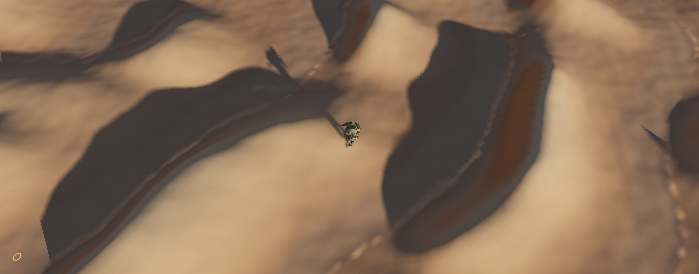

# Report 2026-10-24T05-51-49-walker

The step/bullet decals perfist probably a bit too long and they are not lit as expected, or they don't respond to shadows (this creates bright spots on shaded areas ont he ground.

- Lab: walker
- About: {"selected":null,"topic":null}
- URL: http://localhost:5173/labs/walker/
- Camera: {"position":[-122.33,72.33,-82.83],"fov":40}



## HUD

```
3.6 ms avg · 3.8 worst · 280 fps
WebGPU · 96 draws · 371k tris
0.0 m/s · 3.0 steps/s · walk
L planted · R planted · reach misses 0.05% · dust 0
torso 20° from legs · spin L 0% R 0% · ammo L 848 R 896 · hits sand 656 steel 0
```

## Tuning values

```json
{
 "walkSpeed": 8,
 "sprintSpeed": 14,
 "accel": 3,
 "decel": 5,
 "turnRate": 120,
 "turnSlow": 0.6,
 "strideBase": 2.3,
 "stridePerSpeed": 0.4,
 "duty": 0.64,
 "dutyFast": 0.54,
 "stanceBack": 0.22,
 "moveLean": 4,
 "liftHeight": 0.75,
 "liftHold": 0.14,
 "liftBox": 0.8,
 "stomp": 1,
 "stompShare": 0.16,
 "rollOff": 48,
 "rollStart": 0.6,
 "swingCurl": 30,
 "footClear": 0.3,
 "hipHeight": 3.049999952316284,
 "hipWidth": 0.7799999713897705,
 "footSpread": 0.97,
 "walkSpread": 0.66,
 "toeOut": 6,
 "kneeOut": 6,
 "bob": 0.06,
 "impact": 2.2,
 "weightShift": 0.08,
 "crunchRoll": 4,
 "shoulderLevel": 0.8,
 "speedLean": 1.5,
 "slopePitch": 0.35,
 "footTiltMax": 28,
 "downhillReach": 0.55,
 "thighFold": 300,
 "thighSplay": 90,
 "uphillSlow": 0.35,
 "downhillPlant": 0.2,
 "downhillCrouch": 0.3,
 "downhillSitBack": 0,
 "downhillLevel": 0.25,
 "femur": 1.7171487636796257,
 "shin": 0.748732256949777,
 "cannon": 1.0831002710444873,
 "cannonRake": 22.344014025427512,
 "swingTuck": 30,
 "hockExtend": 0.45,
 "hockCompress": 3,
 "hockMinSlow": 18,
 "hockMinFast": 3,
 "ankleHeight": 0.1525000035762787,
 "ankleBack": 0,
 "toeHinge": 0.14,
 "toeLength": 0.85,
 "toeCurl": 40,
 "torsoTurnRate": 150,
 "torsoLimit": 120,
 "podYawMax": 30,
 "podPitchMax": 20,
 "podTrack": 12,
 "spinUp": 0.8,
 "spinDown": 1.4,
 "spinRpm": 900,
 "fireFrom": 0.65,
 "fireRate": 16,
 "spread": 3,
 "range": 45,
 "recoil": 0.03,
 "recoilReturn": 9,
 "recoilMax": 0.14,
 "torsoKick": 0.25,
 "outwardTrack": 0.55,
 "spinSplit": 0.15,
 "rateSplit": 0.06,
 "fireCone": 4,
 "gunSpacing": 1.02,
 "ammoPerGun": 1200,
 "tracerSpeed": 220,
 "tracerLength": 1.2,
 "tracerEvery": 1,
 "flashSize": 1,
 "flashLight": 40,
 "hitDust": 2.1,
 "casingKick": 1.5,
 "sandGrit": 12,
 "metalSparks": 9,
 "metalSparkSpeed": 11,
 "metalSmoke": 1,
 "masterVolume": 0.35,
 "spitLevel": 0.05,
 "growlLevel": 1.22,
 "spinLevel": 0.375,
 "brapLevel": 0.19,
 "dirtLevel": 0.32,
 "metalLevel": 0.3,
 "casingLevel": 0.18,
 "growlDetune": 1.7,
 "celShading": 0,
 "inkWidth": 0,
 "paintRoughness": 0.55,
 "paintMetal": 0.05,
 "shadeFloor": 0.42,
 "shadeMid": 0.72,
 "camPitch": 50,
 "camDist": 40,
 "camNearPitch": 45,
 "camNearDist": 12,
 "camFarPitch": 55,
 "camFarDist": 80,
 "camFollow": 6,
 "camYaw": 0,
 "camFov": 40,
 "seed": 7,
 "windAngle": 25,
 "spacing": 44,
 "height": 14,
 "slip": 0.24,
 "flats": 0.25,
 "meander": 0.7,
 "warp": 0.45,
 "breakup": 0.85,
 "cross": 0.55,
 "variety": 0.6,
 "swell": 5,
 "swellScale": 420,
 "bumps": 0.25,
 "crestSoft": 0.06,
 "chunkSize": 80,
 "segments": 64,
 "radius": 4,
 "budgetMs": 4,
 "facets": 0,
 "sandGrain": 0.5,
 "sandSpecks": 0.45,
 "sandRipples": 0.25,
 "sunAzimuth": 215,
 "sunElevation": 12,
 "sunIntensity": 3.2,
 "envIntensity": 0.5,
 "skyFill": 0,
 "exposure": 1,
 "toneMap": 0,
 "haze": 0.5,
 "shadowBox": 30,
 "shadowSoft": 6,
 "dustWindAngle": 70,
 "windSpeed": 2.55,
 "cloudLife": 5,
 "cloudGrow": 3.5,
 "cloudRise": 0.35,
 "cloudDrag": 1.4,
 "cloudDensity": 0.65,
 "turbulence": 3,
 "clumpLife": 1.3,
 "clumpDensity": 0.85,
 "clumpDrag": 3.2,
 "stompCloud": 6,
 "stompClump": 7,
 "stompSize": 0.9,
 "stompSpeed": 2.8,
 "kickCloud": 3,
 "kickClump": 5,
 "kickSize": 0.7,
 "kickSpeed": 3,
 "sprintKick": 1.8,
 "hitCloud": 2,
 "hitClump": 4,
 "hitSize": 0.45,
 "hitCarry": 5,
 "plumePuffs": 6,
 "plumeSpeed": 7,
 "plumeLean": 0.55,
 "plumeSpread": 0.22,
 "plumeSize": 0.3,
 "plumeDensity": 0.85,
 "plumeDrag": 2.6,
 "sprayCount": 10,
 "spraySpeed": 11,
 "spraySize": 0.12,
 "sprayLean": 0.7,
 "windIn": 1.2,
 "wheelDust": 0.9,
 "wheelClump": 0.5,
 "stepPush": 0.7,
 "gravelDust": 0.25,
 "gravelClump": 0.35,
 "dirtDust": 0.3,
 "dirtClump": 0.7,
 "concreteDust": 0,
 "concreteClump": 0,
 "dustBright": 1,
 "dustShade": 0.85,
 "edgeFray": 0.7,
 "billow": 0.7,
 "inShadow": 1,
 "dustShadowBlur": 0.6,
 "grain": 0.35,
 "softDistance": 1.2,
 "shadowStrength": 0.45,
 "shadowSize": 1.1,
 "markDepth": 0.9,
 "markLife": 45,
 "markDark": 0.55,
 "printSize": 1,
 "craterSize": 0.55,
 "craterEvery": 3,
 "slideOnSlope": 1,
 "hull": 1000,
 "roundDamage": 9,
 "hitRadius": 1.7,
 "respawn": 4
}
```
