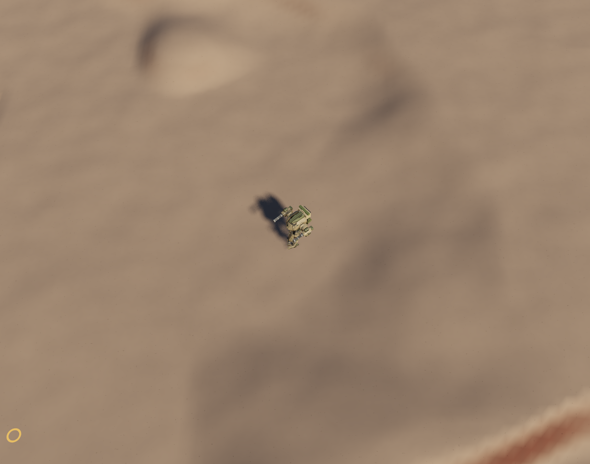

# Report 2026-10-25T03-48-03-pois

we seem to have lost our dust particles on hit in and on footprints on this map?

- Lab: pois
- About: {"selected":null,"topic":"light","hull":1500,"scrap":39,"focus":"outcrop"}
- URL: http://localhost:5173/labs/pois/?biome=rocky
- Camera: {"position":[-66.24,76.6,190.19],"fov":40}



## HUD

```
3.9 ms avg · 9.6 worst · 256 fps
WebGPU · 105 draws · 421k tris
POIs drawn 20 · focus Rock outcrop (0 scrap left) · sections banked 1 · noise pulses 8
hull ████████████████████ 1500/1500
bodies 0 (0 moving)
dash ●● (Space) · ammo L 1102 R 1120 · dust 0
```

## Tuning values

```json
{
 "walkSpeed": 4,
 "sprintSpeed": 6.5,
 "accel": 3,
 "decel": 5,
 "turnRate": 120,
 "turnSlow": 0.6,
 "strideBase": 2.3,
 "stridePerSpeed": 0.4,
 "duty": 0.64,
 "dutyFast": 0.54,
 "stanceBack": 0.22,
 "moveLean": 4,
 "liftHeight": 0.75,
 "liftHold": 0.14,
 "liftBox": 0.8,
 "stomp": 1,
 "stompShare": 0.16,
 "rollOff": 48,
 "rollStart": 0.6,
 "swingCurl": 30,
 "footClear": 0.3,
 "hipHeight": 3.049999952316284,
 "hipWidth": 0.7799999713897705,
 "footSpread": 0.97,
 "walkSpread": 0.66,
 "toeOut": 6,
 "kneeOut": 6,
 "bob": 0.06,
 "impact": 2.2,
 "weightShift": 0.08,
 "crunchRoll": 4,
 "shoulderLevel": 0.8,
 "speedLean": 1.5,
 "slopePitch": 0.35,
 "footTiltMax": 28,
 "downhillReach": 0.55,
 "thighFold": 300,
 "thighSplay": 90,
 "uphillSlow": 0.35,
 "downhillPlant": 0.2,
 "downhillCrouch": 0.3,
 "downhillSitBack": 0,
 "downhillLevel": 0.25,
 "femur": 1.7171487636796257,
 "shin": 0.748732256949777,
 "cannon": 1.0831002710444873,
 "cannonRake": 22.344014025427512,
 "swingTuck": 30,
 "hockExtend": 0.45,
 "hockCompress": 3,
 "hockMinSlow": 18,
 "hockMinFast": 3,
 "ankleHeight": 0.1525000035762787,
 "ankleBack": 0,
 "toeHinge": 0.14,
 "toeLength": 0.85,
 "toeCurl": 40,
 "torsoTurnRate": 150,
 "torsoLimit": 120,
 "podYawMax": 30,
 "podPitchMax": 20,
 "podTrack": 12,
 "spinUp": 0.8,
 "spinDown": 1.4,
 "spinRpm": 900,
 "fireFrom": 0.65,
 "fireRate": 16,
 "spread": 3,
 "range": 45,
 "recoil": 0.03,
 "recoilReturn": 9,
 "recoilMax": 0.14,
 "torsoKick": 0.25,
 "outwardTrack": 0.55,
 "spinSplit": 0.15,
 "rateSplit": 0.06,
 "fireCone": 4,
 "gunSpacing": 1.02,
 "ammoPerGun": 1200,
 "tracerSpeed": 220,
 "tracerLength": 1.2,
 "tracerEvery": 1,
 "flashSize": 1,
 "flashLight": 40,
 "hitDust": 2.1,
 "casingKick": 1.5,
 "sandGrit": 5,
 "metalSparks": 9,
 "metalSparkSpeed": 11,
 "metalSmoke": 1,
 "sparkSize": 2.5,
 "masterVolume": 0.35,
 "spitLevel": 0.05,
 "growlLevel": 1.22,
 "spinLevel": 0.375,
 "brapLevel": 0.19,
 "dirtLevel": 0.32,
 "metalLevel": 0.3,
 "casingLevel": 0.18,
 "grindLevel": 0.3,
 "growlDetune": 1.7,
 "celShading": 0,
 "inkWidth": 0,
 "paintRoughness": 0.55,
 "paintMetal": 0.05,
 "shadeFloor": 0.42,
 "shadeMid": 0.72,
 "camPitch": 50,
 "camDist": 40,
 "camNearPitch": 45,
 "camNearDist": 12,
 "camFarPitch": 55,
 "camFarDist": 80,
 "camFollow": 6,
 "camYaw": 0,
 "camFov": 40,
 "seed": 7,
 "windAngle": 25,
 "spacing": 44,
 "height": 14,
 "slip": 0.24,
 "flats": 0.25,
 "meander": 0.7,
 "warp": 0.45,
 "breakup": 0.85,
 "cross": 0.55,
 "variety": 0.6,
 "swell": 5,
 "swellScale": 420,
 "bumps": 0.25,
 "crestSoft": 0.06,
 "chunkSize": 64,
 "segments": 64,
 "radius": 4,
 "budgetMs": 4,
 "facets": 0,
 "sandGrain": 0.5,
 "sandSpecks": 0.45,
 "sandRipples": 0.25,
 "sunAzimuth": 215,
 "sunElevation": 36,
 "sunIntensity": 4,
 "envIntensity": 0.5,
 "skyFill": 0,
 "exposure": 1,
 "toneMap": 0,
 "haze": 0.5,
 "shadowBox": 40,
 "shadowSoft": 6,
 "dustWindAngle": 70,
 "windSpeed": 1.4,
 "cloudLife": 5,
 "cloudGrow": 3.5,
 "cloudRise": 0.35,
 "cloudDrag": 1.4,
 "cloudDensity": 0.65,
 "turbulence": 0.5,
 "clumpLife": 1.3,
 "clumpDensity": 0.85,
 "clumpDrag": 3.2,
 "stompCloud": 6,
 "stompClump": 7,
 "stompSize": 0.9,
 "stompSpeed": 2.8,
 "kickCloud": 3,
 "kickClump": 5,
 "kickSize": 0.7,
 "kickSpeed": 3,
 "sprintKick": 1.8,
 "hitCloud": 2,
 "hitClump": 4,
 "hitSize": 0.45,
 "hitCarry": 5,
 "plumePuffs": 6,
 "plumeSpeed": 7,
 "plumeLean": 0.55,
 "plumeSpread": 0.22,
 "plumeSize": 0.3,
 "plumeDensity": 0.85,
 "plumeDrag": 2.6,
 "sprayCount": 10,
 "spraySpeed": 11,
 "spraySize": 0.12,
 "sprayLean": 0.7,
 "windIn": 1.2,
 "wheelDust": 0.9,
 "wheelClump": 0.5,
 "stepPush": 0.7,
 "gravelDust": 0.25,
 "gravelClump": 0.35,
 "dirtDust": 0.3,
 "dirtClump": 0.7,
 "concreteDust": 0,
 "concreteClump": 0,
 "dustBright": 1,
 "dustShade": 0.85,
 "edgeFray": 0.7,
 "billow": 0.7,
 "inShadow": 0.6,
 "dustShadowBlur": 0.6,
 "grain": 0.35,
 "softDistance": 1.2,
 "shadowStrength": 0.45,
 "shadowSize": 1.1,
 "markDepth": 0.9,
 "markLife": 20,
 "markDark": 0.55,
 "markRim": 0.4,
 "printSize": 1,
 "craterSize": 0.35,
 "craterEvery": 3,
 "slideOnSlope": 1,
 "dashDistance": 9,
 "dashTime": 0.45,
 "dashCharges": 2,
 "dashRecharge": 3,
 "dashGap": 0.25,
 "dashCrouch": 0.35,
 "dashLean": 9,
 "dashShoveRadius": 4,
 "dashShove": 10,
 "dashShoveDamage": 6,
 "dashDamageCut": 0.5,
 "hull": 1500,
 "roundDamage": 9,
 "roundPierce": 2,
 "roundPierceKeep": 0.7,
 "roundSplash": 1.6,
 "roundSplashShare": 0.5,
 "hitRadius": 1.7,
 "respawn": 4,
 "deathPush": 1,
 "deathLift": 0.5,
 "deathSpin": 1,
 "jointDamping": 2,
 "liveFor": 7,
 "maxRagdolls": 30,
 "bodyStays": 14,
 "floorSize": 120,
 "autoLock": 1,
 "lockCursor": 1.5,
 "lockWidth": 2,
 "lockCone": 6,
 "lockSticky": 0.4,
 "lockLead": 0.12,
 "markOpacity": 0.85,
 "markWidth": 0.35,
 "shellGlow": 1,
 "rippleSpeed": 2.2,
 "rippleLife": 2.2,
 "rippleSize": 1,
 "rippleWidth": 0.18,
 "rippleStrength": 0.8,
 "wakeEvery": 1.2,
 "splashDrops": 14,
 "splashSpeed": 4.5,
 "splashSize": 1,
 "biomeSize": 5000,
 "biomeBlend": 300,
 "biomeWarp": 0.3,
 "biomeEdgeWiggle": 40,
 "desertShare": 1,
 "rockyShare": 1,
 "shallowsShare": 0.7,
 "biomeOnly": 1,
 "rockHeight": 22,
 "rockScale": 170,
 "rockStep": 4.5,
 "rockFace": 0.3,
 "rockTerrace": 0.8,
 "rockRidge": 0.45,
 "rockRough": 0.25,
 "rockSand": 0.35,
 "waterLevel": -1.5,
 "shallowDepth": 0.9,
 "barHeight": 0.5,
 "barShare": 0.16,
 "barScale": 90,
 "outcropShare": 0.1,
 "outcropHeight": 4,
 "outcropScale": 40,
 "waterClear": 0.3,
 "waterDeep": 0.85,
 "poiSeed": 1,
 "poiCell": 400,
 "poiChance": 0.75,
 "poiSpacing": 140,
 "poiTries": 6,
 "tier1Weight": 1,
 "tier2Weight": 0.5,
 "tier3Weight": 1,
 "tier4Weight": 1,
 "tier5Weight": 0.25,
 "bigChance": 0.6,
 "padBlend": 14,
 "padRough": 0.15,
 "debrisPad": 20,
 "convoyPad": 8,
 "convoyPadHalf": 18,
 "outcropRocks": 6,
 "outcropSize": 3.2,
 "outcropValue": 22,
 "outcropTime": 2.5,
 "wreckScale": 1.4,
 "wreckPlateChance": 0.5,
 "wreckValue": 34,
 "wreckTime": 3.5,
 "podLength": 5,
 "podValue": 60,
 "podTime": 5,
 "podCrateValue": 12,
 "debrisSpotsMin": 4,
 "debrisSpotsMax": 8,
 "debrisClutter": 60,
 "debrisValue": 18,
 "debrisTime": 3,
 "deadMin": 2,
 "deadMax": 4,
 "deadGap": 11,
 "deadValue": 28,
 "deadTime": 3.5,
 "deadTipped": 0.3,
 "salvageReach": 7,
 "stripSpeed": 1,
 "scrapScale": 1,
 "noiseEvery": 0.6,
 "noiseRadius": 160,
 "stripSparks": 70,
 "stripBits": 6,
 "markerSize": 1,
 "barWidth": 4.5,
 "mapSize": 4000,
 "showRing": 60,
 "drawRadius": 900
}
```
