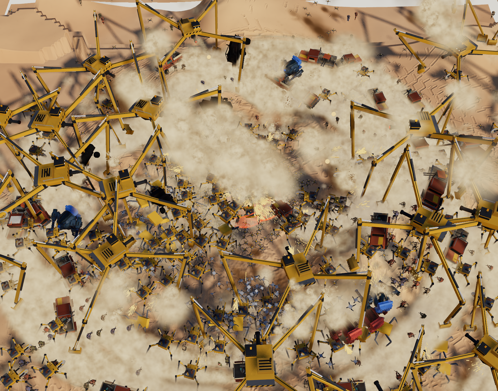

# Report 2026-10-27T02-04-36-stress

| stage | 25% avg / worst | 50% avg / worst | 100% avg / worst | 150% avg / worst |
| --- | --- | --- | --- | --- |
| frame | 12.6 / 28.9 | 17.5 / 32.1 | 27.9 / 48.9 | 44.7 / 61.5 |
| tick (all sim) | 7.03 / 23.1 | 11.6 / 26.2 | 20.4 / 41.4 | 35.0 / 52.0 |
| render (submit) | 5.28 / 17.3 | 5.63 / 9.60 | 7.11 / 9.30 | 9.24 / 11.5 |
| gpu/wait | 1.14 / 12.9 | 1.38 / 11.0 | 1.90 / 13.1 | 2.61 / 19.7 |
| craters | 0.12 / 12.7 | 0.47 / 9.20 | 3.82 / 21.3 | 14.0 / 31.4 |
| robots draw | 1.04 / 1.50 | 1.95 / 2.80 | 4.07 / 12.1 | 4.11 / 4.80 |
| ground dents | 0.98 / 3.70 | 2.22 / 3.50 | 2.66 / 6.10 | 3.30 / 3.50 |
| deaths physics | 1.12 / 6.80 | 1.56 / 5.80 | 2.09 / 8.40 | 2.68 / 7.70 |
| war band | 0.29 / 0.60 | 0.51 / 4.00 | 1.34 / 5.30 | 2.38 / 5.40 |
| robots sim | 0.60 / 1.50 | 1.25 / 2.40 | 1.85 / 4.60 | 1.83 / 4.70 |
| shots | 0.52 / 2.50 | 0.49 / 2.00 | 0.57 / 2.50 | 1.76 / 4.30 |
| dents | 0.46 / 10.9 | 0.65 / 11.7 | 0.64 / 11.7 | 0.98 / 11.1 |
| bandits sim | 0.13 / 0.40 | 0.25 / 0.70 | 0.52 / 1.10 | 0.80 / 0.90 |
| allies + protocols | 0.35 / 1.00 | 0.39 / 0.80 | 0.69 / 1.50 | 0.78 / 1.30 |
| deaths draw | 0.45 / 1.00 | 0.74 / 1.50 | 0.74 / 1.40 | 0.76 / 1.10 |
|   inside the above: register queries | 0.08 / 0.60 | 0.10 / 0.70 | 0.16 / 0.80 | 0.61 / 1.90 |
| gun fx | 0.36 / 0.80 | 0.39 / 0.80 | 0.39 / 0.80 | 0.52 / 1.10 |
| mech + weapons | 0.17 / 0.70 | 0.18 / 0.40 | 0.34 / 1.30 | 0.30 / 0.80 |
| dust | 0.16 / 0.40 | 0.15 / 0.50 | 0.18 / 0.50 | 0.17 / 0.30 |
| register | 0.04 / 0.30 | 0.07 / 0.20 | 0.12 / 0.50 | 0.15 / 0.30 |
|   inside the above: register rebuild | 0.04 / 0.30 | 0.07 / 0.20 | 0.12 / 0.50 | 0.14 / 0.30 |
| bandits draw | 0.03 / 0.20 | 0.04 / 0.20 | 0.09 / 0.30 | 0.14 / 0.30 |
| input + lock | 0.08 / 1.20 | 0.09 / 0.20 | 0.10 / 0.40 | 0.11 / 0.50 |
| camera | 0.02 / 0.20 | 0.03 / 0.20 | 0.07 / 0.40 | 0.07 / 0.30 |
| terrain streaming | 0.05 / 0.20 | 0.05 / 0.20 | 0.06 / 0.30 | 0.06 / 0.20 |
| barrage blasts | 0.02 / 1.10 | 0.03 / 0.90 | 0.03 / 0.90 | 0.04 / 0.80 |
| spawning | 0.01 / 0.10 | 0.02 / 2.10 | 0.03 / 2.20 | 0.03 / 0.80 |
| weapons draw | 0.01 / 0.20 | 0.01 / 0.10 | 0.01 / 0.10 | 0.02 / 0.10 |
| light | 0.00 / 0.10 | 0.00 / 0.10 | 0.00 / 0.10 | 0.01 / 0.10 |
| lab | 0.00 / 0.10 | 0.00 / 0.10 | 0.00 / 0.10 | 0.00 / 0.10 |

| on the field (avg) | 25% | 50% | 100% | 150% |
| --- | --- | --- | --- | --- |
| register entries | 381 | 759 | 1518 | 1777 |
| register queries | 50 | 53 | 49 | 107 |
| robots | 249 | 499 | 998 | 997 |
| bandits | 125 | 250 | 500 | 750 |
| vehicles | 5 | 8 | 17 | 27 |
| bandit mechs | 1 | 1 | 2 | 3 |
| bodies | 267 | 699 | 1048 | 1473 |
| dust particles | 26491 | 24145 | 19293 | 22801 |
| dust puffs asked | 501 | 529 | 376 | 846 |
| effects asked | 28 | 56 | 144 | 390 |
| effects thinned | 9 | 8 | 39 | 53 |
| hits merged | 0 | 1 | 1 | 1 |
| budget pressure ×100 | 101 | 87 | 69 | 82 |
| team gun shots | 1 | 1 | 0 | 1 |
| of which allies | 0 | 0 | 0 | 0 |
| rounds resolved (all teams) | 4 | 4 | 6 | 19 |
| ricochets | 4 | 3 | 2 | 3 |
| chain hops | 1 | 2 | 2 | 5 |
| shot commands (all teams) | 1 | 1 | 4 | 16 |
| shot hits | 3 | 5 | 8 | 24 |
| draw calls | 482 | 553 | 739 | 1056 |
| triangles (k) | 2204 | 3143 | 5079 | 6482 |

- Lab: stress
- About: {"selected":null,"topic":null,"hull":1449,"pilot":"in","robots":925,"bandits":495,"vehicles":23,"run":"| stage | 25% avg / worst | 50% avg / worst | 100% avg / worst | 150% avg / worst |\n| --- | --- | --- | --- | --- |\n| frame | 12.6 / 28.9 | 17.5 / 32.1 | 27.9 / 48.9 | 44.7 / 61.5 |\n| tick (all sim) | 7.03 / 23.1 | 11.6 / 26.2 | 20.4 / 41.4 | 35.0 / 52.0 |\n| render (submit) | 5.28 / 17.3 | 5.63 / 9.60 | 7.11 / 9.30 | 9.24 / 11.5 |\n| gpu/wait | 1.14 / 12.9 | 1.38 / 11.0 | 1.90 / 13.1 | 2.61 / 19.7 |\n| craters | 0.12 / 12.7 | 0.47 / 9.20 | 3.82 / 21.3 | 14.0 / 31.4 |\n| robots draw | 1.04 / 1.50 | 1.95 / 2.80 | 4.07 / 12.1 | 4.11 / 4.80 |\n| ground dents | 0.98 / 3.70 | 2.22 / 3.50 | 2.66 / 6.10 | 3.30 / 3.50 |\n| deaths physics | 1.12 / 6.80 | 1.56 / 5.80 | 2.09 / 8.40 | 2.68 / 7.70 |\n| war band | 0.29 / 0.60 | 0.51 / 4.00 | 1.34 / 5.30 | 2.38 / 5.40 |\n| robots sim | 0.60 / 1.50 | 1.25 / 2.40 | 1.85 / 4.60 | 1.83 / 4.70 |\n| shots | 0.52 / 2.50 | 0.49 / 2.00 | 0.57 / 2.50 | 1.76 / 4.30 |\n| dents | 0.46 / 10.9 | 0.65 / 11.7 | 0.64 / 11.7 | 0.98 / 11.1 |\n| bandits sim | 0.13 / 0.40 | 0.25 / 0.70 | 0.52 / 1.10 | 0.80 / 0.90 |\n| allies + protocols | 0.35 / 1.00 | 0.39 / 0.80 | 0.69 / 1.50 | 0.78 / 1.30 |\n| deaths draw | 0.45 / 1.00 | 0.74 / 1.50 | 0.74 / 1.40 | 0.76 / 1.10 |\n|   inside the above: register queries | 0.08 / 0.60 | 0.10 / 0.70 | 0.16 / 0.80 | 0.61 / 1.90 |\n| gun fx | 0.36 / 0.80 | 0.39 / 0.80 | 0.39 / 0.80 | 0.52 / 1.10 |\n| mech + weapons | 0.17 / 0.70 | 0.18 / 0.40 | 0.34 / 1.30 | 0.30 / 0.80 |\n| dust | 0.16 / 0.40 | 0.15 / 0.50 | 0.18 / 0.50 | 0.17 / 0.30 |\n| register | 0.04 / 0.30 | 0.07 / 0.20 | 0.12 / 0.50 | 0.15 / 0.30 |\n|   inside the above: register rebuild | 0.04 / 0.30 | 0.07 / 0.20 | 0.12 / 0.50 | 0.14 / 0.30 |\n| bandits draw | 0.03 / 0.20 | 0.04 / 0.20 | 0.09 / 0.30 | 0.14 / 0.30 |\n| input + lock | 0.08 / 1.20 | 0.09 / 0.20 | 0.10 / 0.40 | 0.11 / 0.50 |\n| camera | 0.02 / 0.20 | 0.03 / 0.20 | 0.07 / 0.40 | 0.07 / 0.30 |\n| terrain streaming | 0.05 / 0.20 | 0.05 / 0.20 | 0.06 / 0.30 | 0.06 / 0.20 |\n| barrage blasts | 0.02 / 1.10 | 0.03 / 0.90 | 0.03 / 0.90 | 0.04 / 0.80 |\n| spawning | 0.01 / 0.10 | 0.02 / 2.10 | 0.03 / 2.20 | 0.03 / 0.80 |\n| weapons draw | 0.01 / 0.20 | 0.01 / 0.10 | 0.01 / 0.10 | 0.02 / 0.10 |\n| light | 0.00 / 0.10 | 0.00 / 0.10 | 0.00 / 0.10 | 0.01 / 0.10 |\n| lab | 0.00 / 0.10 | 0.00 / 0.10 | 0.00 / 0.10 | 0.00 / 0.10 |\n\n| on the field (avg) | 25% | 50% | 100% | 150% |\n| --- | --- | --- | --- | --- |\n| register entries | 381 | 759 | 1518 | 1777 |\n| register queries | 50 | 53 | 49 | 107 |\n| robots | 249 | 499 | 998 | 997 |\n| bandits | 125 | 250 | 500 | 750 |\n| vehicles | 5 | 8 | 17 | 27 |\n| bandit mechs | 1 | 1 | 2 | 3 |\n| bodies | 267 | 699 | 1048 | 1473 |\n| dust particles | 26491 | 24145 | 19293 | 22801 |\n| dust puffs asked | 501 | 529 | 376 | 846 |\n| effects asked | 28 | 56 | 144 | 390 |\n| effects thinned | 9 | 8 | 39 | 53 |\n| hits merged | 0 | 1 | 1 | 1 |\n| budget pressure ×100 | 101 | 87 | 69 | 82 |\n| team gun shots | 1 | 1 | 0 | 1 |\n| of which allies | 0 | 0 | 0 | 0 |\n| rounds resolved (all teams) | 4 | 4 | 6 | 19 |\n| ricochets | 4 | 3 | 2 | 3 |\n| chain hops | 1 | 2 | 2 | 5 |\n| shot commands (all teams) | 1 | 1 | 4 | 16 |\n| shot hits | 3 | 5 | 8 | 24 |\n| draw calls | 482 | 553 | 739 | 1056 |\n| triangles (k) | 2204 | 3143 | 5079 | 6482 |\n| frames recorded | 476 | 343 | 215 | 138 |"}
- URL: http://localhost:4174/labs/stress/?run&worst
- Camera: {"position":[-21.88,67.9,21.28],"fov":40}



## HUD

```
38.4 ms avg · 54.3 worst · 26 fps
WebGPU · 1082 draws · 5315k tris
sim 26.6 ms · submit 10.0 ms · gpu/wait 1.8 ms
LMB — · RMB —
hull ████████████████████ 1498/1500
bodies 1497 (30 moving) · craters 207 (last fit 0.9 ms, chunk patch 2.1 ms, 4378 patches)
effects budget: 307 asked · 42 yours at full · 8 thinned · 0 hits merged · 538 dust puffs · pressure 0.79
dash ●● (Space) · hold Space to sprint · ammo L 1046 R 1055 · dust 22045
cpu ms: craters 9.7 · deaths physics 4.6 · robots draw 4.1 · ground dents 3.3 · war band 2.3 · shots 2.1 · robots sim 1.9 · allies + protocols 0.8 · bandits sim 0.6 · deaths draw 0.5 · gun fx 0.4 · mech + weapons 0.3 · dust 0.2 · register 0.1 · dents 0.1 · input + lock 0.1 · bandits draw 0.1 · terrain streaming 0.1 · camera 0.1 · barrage blasts 0.0 · light 0.0 · weapons draw 0.0 · spawning 0.0 · lab 0.0
robots 978 · bandits 480 · vehicles 23 · bandit mechs 2 · bodies 1497 · worst case: 0 shots (allies 0) → all teams: rounds 11 + ricochets 0 + chain hops 0 this frame · run done: table below
blast dents: 0 queued · last frame 8.3 ms (3 dug) · worst 8.3 ms · one dent 3.0 ms · 444 dug, 83 merged
```

## Tuning values

```json
{
 "sinkSand": 0.35,
 "sinkSnow": 0.22,
 "sinkDirt": 0.04,
 "sinkGravel": 0.025,
 "sinkRock": 0,
 "walkSpeed": 6,
 "sprintSpeed": 8.5,
 "accel": 4,
 "decel": 6,
 "turnRate": 120,
 "turnSlow": 0.6,
 "strideBase": 2.3,
 "stridePerSpeed": 0.4,
 "strideMax": 5.2,
 "duty": 0.64,
 "dutyFast": 0.54,
 "stanceBack": 0.3,
 "moveLean": 4,
 "liftHeight": 0.4,
 "liftHold": 0,
 "liftBox": 0,
 "stomp": 1,
 "stompShare": 0.35,
 "rollOff": 70,
 "rollStart": 0.4,
 "swingCurl": 30,
 "footClear": 0.3,
 "hipHeight": 3.049999952316284,
 "hipWidth": 0.7799999713897705,
 "footSpread": 0.97,
 "walkSpread": 0.66,
 "toeOut": 6,
 "kneeOut": 6,
 "bob": 0.06,
 "runBounce": 1,
 "runCrouch": 0.18,
 "impact": 2.2,
 "weightShift": 0.08,
 "crunchRoll": 4,
 "shoulderLevel": 0.8,
 "speedLean": 1.5,
 "slopePitch": 0.35,
 "footTiltMax": 28,
 "downhillReach": 0.55,
 "thighFold": 300,
 "thighSplay": 90,
 "uphillSlow": 0.35,
 "downhillPlant": 0.2,
 "downhillCrouch": 0.3,
 "downhillSitBack": 0,
 "downhillLevel": 0.25,
 "femur": 1.7171487636796257,
 "shin": 0.748732256949777,
 "cannon": 1.0831002710444873,
 "cannonRake": 22.344014025427512,
 "swingTuck": 45,
 "hockExtend": 0.8,
 "hockCompress": 3,
 "hockMinSlow": 18,
 "hockMinFast": 3,
 "kneeMaxPlanted": 165,
 "toeClear": 0.1,
 "ankleHeight": 0.1525000035762787,
 "ankleBack": 0,
 "toeHinge": 0.14,
 "toeLength": 0.85,
 "toeCurl": 40,
 "leaveG": 1.2,
 "leaveMin": 5,
 "airTuck": 0.72,
 "airReach": 0.97,
 "airFore": 0.35,
 "airSplit": 0.7,
 "airSpread": 1.15,
 "airFold": 25,
 "airPitch": 0.3,
 "airSteer": 0.25,
 "landSoft": 3,
 "landDip": 0.12,
 "landSquat": 0.14,
 "landSquatMax": 1,
 "landRecover": 0.6,
 "landOvershoot": 0.12,
 "landPitch": 10,
 "landHard": 10,
 "landStagger": 0.2,
 "landHurt": 11,
 "landDamage": 40,
 "landFriction": 3,
 "landShake": 0.5,
 "wallGrade": 0.9,
 "wallStop": 1.6,
 "wallScrub": 14,
 "launchUpMax": 6,
 "boundTop": 16,
 "boundBuild": 0.3,
 "boundHop": 6,
 "boundStanceLen": 4,
 "boundStagger": 0.3,
 "boundReach": 0.6,
 "boundSplit": 1.6,
 "boundSwing": 14.5,
 "boundLeadLift": 0.24,
 "boundTuck": 0.8,
 "boundCrouch": 1,
 "boundSquat": 0.41,
 "boundLean": 0,
 "boundGrip": 0.7,
 "boundYaw": 0.6,
 "boundDriftMax": 68,
 "boundSkid": 0.5,
 "boundAbsorb": 7,
 "turnRoll": 1,
 "turnRollMax": 30,
 "turnRollEase": 1,
 "turnLeanShift": 0.25,
 "boundGallop": 0,
 "runSteps": 1.8,
 "runStepsTop": 3,
 "runPlant": 0.5,
 "runBlend": 0.6,
 "runBob": 0.175,
 "runThud": 0.11,
 "runThighUp": 50,
 "runShinBack": 100,
 "runHockFold": 45,
 "runTuckAt": 0.5,
 "runFollow": 0.45,
 "runPaw": 0.8,
 "runFootDrop": 55,
 "runToeCurl": 100,
 "runHockExtend": 1,
 "runRollOff": 85,
 "runRollStart": 0.12,
 "runLookAhead": 0.53,
 "runClear": 3,
 "runClimbSteps": 0.1,
 "runPlantDrop": 0.12,
 "runPlantPitch": 3,
 "runPushRise": 0.05,
 "runDescentSteps": 0,
 "runHurry": 0.3,
 "runReachGive": 0.1,
 "legReachMax": 0.93,
 "swingThighFold": 160,
 "swingFoldFrom": 0.12,
 "uphillLead": 1,
 "dashPushTime": 0.08,
 "dashLeadTime": 0.14,
 "dashLeadReach": 0.6,
 "dashLeadLift": 0.35,
 "dashRecover": 0.3,
 "dashHipOpen": 0.6,
 "dashKneeOut": 50,
 "dashSpreadMax": 2.6,
 "dashIntoRun": 11,
 "idleAfter": 10,
 "idleEvery": 18,
 "idleJitter": 0.6,
 "idleSteps": 4,
 "idleRate": 0.55,
 "idleLift": 0.4,
 "idleClear": 0.09,
 "idleEase": 0.97,
 "idleRoll": 3,
 "idleRollStart": 0.2,
 "idleCurl": 30,
 "idleToes": 40,
 "torsoTurnRate": 150,
 "torsoLimit": 180,
 "podYawMax": 30,
 "podPitchMax": 20,
 "podPitchUp": 50,
 "torsoLeanMax": 12,
 "torsoLeanRate": 40,
 "podTrack": 12,
 "spinUp": 0.8,
 "spinDown": 1.4,
 "spinRpm": 900,
 "fireFrom": 0.65,
 "fireRate": 16,
 "spread": 3,
 "range": 45,
 "recoil": 0.03,
 "recoilReturn": 9,
 "recoilMax": 0.14,
 "torsoKick": 0.25,
 "outwardTrack": 0.55,
 "spinSplit": 0.15,
 "rateSplit": 0.06,
 "fireCone": 4,
 "gunSpacing": 1.02,
 "ammoPerGun": 1200,
 "tracerSpeed": 220,
 "tracerLength": 1.2,
 "tracerEvery": 1,
 "flashSize": 1,
 "flashLight": 40,
 "hitDust": 2.1,
 "casingKick": 1.5,
 "sandGrit": 20,
 "metalSparks": 36,
 "metalSparkSpeed": 11,
 "metalSmoke": 4,
 "sparkSize": 2.5,
 "fxBudget": 1,
 "fxNear": 15,
 "fxThinFrom": 30,
 "fxThinTo": 90,
 "fxFarKeep": 0.3,
 "fxAllyKeep": 0.7,
 "fxDustPerFrame": 400,
 "fxGpuDustPerFrame": 1600,
 "fxLiveShare": 0.85,
 "fxTrimSpan": 1.5,
 "fxMergeCell": 1.5,
 "fxMergeSize": 0.25,
 "fxMergeCount": 0.5,
 "fxGpuBits": 1,
 "fxGpuTracers": 1,
 "fxGpuDust": 1,
 "fxGpuDustPool": 32768,
 "masterVolume": 0.35,
 "spitLevel": 0.05,
 "growlLevel": 1.22,
 "spinLevel": 0.375,
 "brapLevel": 0.19,
 "dirtLevel": 0.32,
 "metalLevel": 0.3,
 "casingLevel": 0.18,
 "grindLevel": 0.3,
 "growlDetune": 1.7,
 "celShading": 0,
 "inkWidth": 0,
 "paintRoughness": 0.55,
 "paintMetal": 0.05,
 "shadeFloor": 0.42,
 "shadeMid": 0.72,
 "camPitch": 50,
 "camDist": 40,
 "camNearPitch": 45,
 "camNearDist": 12,
 "camFarPitch": 55,
 "camFarDist": 80,
 "camFollow": 6,
 "camYaw": 0,
 "camFov": 40,
 "camLead": 0.6,
 "camLeadMax": 14,
 "camLeadFrom": 7,
 "camSpeedZoom": 1.2,
 "camSpeedEase": 1.5,
 "seed": 7,
 "windAngle": 25,
 "spacing": 44,
 "height": 14,
 "slip": 0.24,
 "flats": 0.25,
 "meander": 0.7,
 "warp": 0.45,
 "breakup": 0.85,
 "cross": 0.55,
 "variety": 0.6,
 "swell": 5,
 "swellScale": 420,
 "bumps": 0.25,
 "crestSoft": 0.06,
 "chunkSize": 64,
 "segments": 64,
 "radius": 4,
 "budgetMs": 4,
 "facets": 0,
 "sandGrain": 0.5,
 "sandSpecks": 0.45,
 "sandRipples": 0.25,
 "shadowTerrain": 1,
 "shadowSpacing": 4,
 "shadowSink": 0.3,
 "sunAzimuth": 215,
 "sunElevation": 36,
 "sunIntensity": 3.2,
 "envIntensity": 0.5,
 "skyFill": 0,
 "exposure": 1,
 "toneMap": 0,
 "haze": 0.5,
 "shadowBox": 40,
 "shadowSoft": 6,
 "dustWindAngle": 70,
 "windSpeed": 1.4,
 "cloudLife": 5,
 "cloudGrow": 3.5,
 "cloudRise": 0.35,
 "cloudDrag": 1.4,
 "cloudDensity": 0.65,
 "turbulence": 0.5,
 "clumpLife": 1.3,
 "clumpDensity": 0.85,
 "clumpDrag": 3.2,
 "stompCloud": 4,
 "stompClump": 4,
 "stompSize": 0.8,
 "stompSpeed": 2,
 "kickCloud": 12,
 "kickClump": 20,
 "kickSize": 0.7,
 "kickSpeed": 3,
 "sprintKick": 1.8,
 "hitCloud": 8,
 "hitClump": 16,
 "hitSize": 0.45,
 "hitCarry": 5,
 "plumePuffs": 24,
 "plumeSpeed": 7,
 "plumeLean": 0.55,
 "plumeSpread": 0.22,
 "plumeSize": 0.3,
 "plumeDensity": 0.85,
 "plumeDrag": 2.6,
 "sprayCount": 40,
 "spraySpeed": 11,
 "spraySize": 0.12,
 "sprayLean": 0.7,
 "windIn": 1.2,
 "wheelDust": 3.6,
 "wheelClump": 2,
 "slideDust": 1.2,
 "slideClump": 2.2,
 "slideThrow": 0.6,
 "slideMin": 1.5,
 "stepPush": 0.7,
 "gravelDust": 0.25,
 "gravelClump": 0.35,
 "dirtDust": 0.3,
 "dirtClump": 0.7,
 "concreteDust": 0,
 "concreteClump": 0,
 "dustBright": 1,
 "dustShade": 0.85,
 "edgeFray": 0.7,
 "billow": 0.7,
 "inShadow": 0.6,
 "dustShadowBlur": 0.6,
 "grain": 0.35,
 "softDistance": 1.2,
 "shadowStrength": 0.45,
 "shadowSize": 1.1,
 "dustCullMargin": 15,
 "dustGroundRefresh": 1.5,
 "dustGroundEvery": 30,
 "dustSunEvery": 8,
 "dentCoverage": 100,
 "dentRes": 2048,
 "patchSpacing": 0.25,
 "patchEdge": 4,
 "patchBudget": 3,
 "dentScale": 1,
 "dentPrint": 0.1,
 "dentRut": 0.06,
 "dentRutWidth": 1,
 "dentFurrow": 0.12,
 "dentRound": 0.05,
 "dentRoundEvery": 1,
 "dentHitDepth": 0.06,
 "dentHitSize": 0.15,
 "dentHitOpen": 1,
 "dentHitLength": 4,
 "dentHitAngle": 1,
 "dentBlast": 0.14,
 "dentComp": 0.6,
 "dentDark": 0.22,
 "dentRough": 0.6,
 "dentMaxDepth": 0.6,
 "dentRelaxStep": 0.3,
 "printSize": 1,
 "craterSize": 0.35,
 "slideOnSlope": 1,
 "dentSandDepth": 1,
 "dentSandBerm": 1,
 "dentSandSoften": 6,
 "dentSandSlump": 0.5,
 "dentSandLife": 90,
 "dentDirtDepth": 0.45,
 "dentDirtBerm": 0.5,
 "dentDirtSoften": 1.5,
 "dentDirtSlump": 0.1,
 "dentDirtLife": 400,
 "dentGravelDepth": 0.3,
 "dentGravelBerm": 0.6,
 "dentGravelSoften": 2,
 "dentGravelSlump": 0.1,
 "dentGravelLife": 300,
 "dentSnowDepth": 2.5,
 "dentSnowBerm": 0.35,
 "dentSnowSoften": 1,
 "dentSnowSlump": 0.02,
 "dentSnowLife": 900,
 "dashDistance": 14,
 "dashTime": 1.05,
 "dashPushShare": 0.44,
 "dashCharges": 2,
 "dashRecharge": 3,
 "dashGap": 0.25,
 "dashCrouch": 1.2,
 "dashLean": 25,
 "dashShoveRadius": 4,
 "dashShove": 5,
 "dashShoveDamage": 6,
 "dashDamageCut": 0.5,
 "dashSlope": 1.5,
 "slideFriction": 5,
 "dashCarry": 4,
 "slideMax": 16,
 "boostFuel": 0,
 "boostRegen": 0.35,
 "headTurnRate": 260,
 "headYawMax": 75,
 "headPitchUp": 25,
 "headPitchDown": 35,
 "headLag": 0.09,
 "headSettle": 0.7,
 "headLead": 0.5,
 "headLookAhead": 0.3,
 "headLookAheadMax": 30,
 "headScanWidth": 40,
 "headScanPeriod": 7,
 "headScanAfter": 1.2,
 "clusterSweep": 1,
 "headSize": 0.33,
 "headDrop": 0.12,
 "headForward": 0.25,
 "boundTap": 0.2,
 "dashHoldRun": 0.15,
 "boostTop": 8,
 "boostGlide": 0,
 "boostBurn": 0.25,
 "sprintGunsAfter": 0.6,
 "sprintFaceDrift": 0.5,
 "sprintHullLean": 8,
 "airGunSpread": 3,
 "sprintPushDust": 0.8,
 "sprintToeDig": 1.2,
 "sprintShake": 0.05,
 "sprintThump": 0.35,
 "boundDust": 0.5,
 "hull": 1500,
 "roundDamage": 9,
 "roundPierce": 2,
 "roundPen": 1,
 "roundPenCurve": 1.75,
 "roundSheetHalf": 0.35,
 "roundSheetHeight": 10,
 "roundLine": 0.5,
 "roundSplash": 1.6,
 "roundSplashShare": 0.5,
 "hitRadius": 1.7,
 "respawn": 4,
 "deathPush": 1,
 "deathLift": 0.5,
 "deathSpin": 1,
 "jointDamping": 2,
 "liveFor": 7,
 "maxRagdolls": 30,
 "bodyStays": 14,
 "floorSize": 120,
 "ragdollsPerFrame": 6,
 "autoLock": 1,
 "lockCursor": 1.5,
 "lockWidth": 2,
 "lockCone": 6,
 "lockSticky": 0.4,
 "lockLead": 0.12,
 "sensorLock": 0,
 "markOpacity": 0.85,
 "markWidth": 0.35,
 "shellGlow": 1,
 "rippleSpeed": 2.2,
 "rippleLife": 2.2,
 "rippleSize": 1,
 "rippleWidth": 0.18,
 "rippleStrength": 0.8,
 "wakeEvery": 1.2,
 "splashDrops": 14,
 "splashSpeed": 4.5,
 "splashSize": 1,
 "biomeSize": 5000,
 "biomeBlend": 300,
 "biomeWarp": 0.3,
 "biomeEdgeWiggle": 40,
 "desertShare": 1,
 "rockyShare": 1,
 "shallowsShare": 0.7,
 "biomeOnly": 0,
 "rockHeight": 22,
 "rockScale": 170,
 "rockStep": 4.5,
 "rockFace": 0.3,
 "rockTerrace": 0.8,
 "rockRidge": 0.45,
 "rockRough": 0.25,
 "rockSand": 0.35,
 "waterLevel": -1.5,
 "shallowDepth": 0.9,
 "barHeight": 0.5,
 "barShare": 0.16,
 "barScale": 90,
 "outcropShare": 0.1,
 "outcropHeight": 4,
 "outcropScale": 40,
 "waterClear": 0.3,
 "waterDeep": 0.85,
 "craterRadiusShare": 0.7,
 "craterDepthShare": 0.3,
 "craterRim": 0.8,
 "craterMaxDepth": 1.5,
 "craterMaxStack": 2.5,
 "craterWall": 30,
 "craterSlump": 180,
 "craterMax": 200,
 "hardRock": 0.95,
 "hardRockySand": 0.6,
 "hardShallows": 0.15,
 "protectMargin": 4,
 "paintOpacity": 0.85,
 "paintPulse": 3,
 "paintEdge": 0.35,
 "beamWidth": 0.09,
 "beamGlow": 1,
 "salvoRockets": 10,
 "salvoLength": 25,
 "salvoWidth": 4,
 "salvoMinRange": 8,
 "salvoMaxRange": 70,
 "salvoRipple": 0.07,
 "salvoLandGap": 0.06,
 "salvoSpeed": 34,
 "salvoRise": 12,
 "salvoArc": 9,
 "salvoScatter": 0.6,
 "salvoBlast": 2.6,
 "salvoDamage": 140,
 "salvoCooldown": 6,
 "salvoSnap": 0.8,
 "salvoSnapReach": 5,
 "salvoSmoke": 0.6,
 "railCharge": 0.7,
 "railMinCharge": 0.3,
 "railGrace": 0.15,
 "railDamage": 900,
 "railRange": 90,
 "railPen": 10,
 "railSheetHalf": 0.6,
 "railSheetHeight": 10,
 "railSlugHeight": 1.6,
 "railKnock": 9,
 "railCooldown": 1.2,
 "railKick": 0.45,
 "railShake": 0.6,
 "railStreak": 0.06,
 "railTrail": 0.8,
 "railWisp": 1,
 "railBlast": 1,
 "railCoilArcs": 1,
 "railLightDamage": 0.55,
 "railLightCharge": 0.7,
 "railLightPen": 0.6,
 "mortarShells": 1,
 "mortarRing": 1.5,
 "mortarBlast": 7,
 "mortarDamage": 650,
 "mortarFlight": 3,
 "mortarArc": 22,
 "mortarClear": 3,
 "mortarGap": 0.28,
 "mortarLead": 1,
 "mortarCooldown": 10,
 "mortarMaxRange": 90,
 "acRate": 3.2,
 "acSpeed": 75,
 "acGravity": 6,
 "acDamage": 55,
 "acSplash": 1.8,
 "acSplashShare": 0.6,
 "acSpread": 0.6,
 "acRange": 70,
 "acLead": 1,
 "acPen": 1.5,
 "acSheetHalf": 0.4,
 "acSheetUp": 4,
 "rpgSpeed": 55,
 "rpgDamage": 380,
 "rpgBlast": 4.5,
 "rpgCooldown": 2.2,
 "rpgShoulderCooldown": 4,
 "rpgRange": 70,
 "rpgSmoke": 1,
 "swarmMissiles": 10,
 "swarmDamage": 90,
 "swarmBlast": 2.2,
 "swarmRadius": 8,
 "swarmCooldown": 8,
 "swarmRipple": 0.06,
 "swarmRise": 12,
 "swarmFan": 2.5,
 "swarmSpeed": 40,
 "swarmDrop": 10,
 "laserDay": 0.12,
 "laserNight": 0.75,
 "laserWidth": 0.035,
 "laserGlisten": 1,
 "laserRange": 60,
 "dentBudget": 6,
 "dentMerge": 0.6,
 "blastGroundReach": 0.5,
 "blastShake": 0.35,
 "blastShakeReach": 45,
 "shakeDecay": 9,
 "railLevel": 0.6,
 "rocketLevel": 0.45,
 "blastLevel": 0.6,
 "mortarLevel": 0.5,
 "cannonLevel": 0.45,
 "penFlesh": 0.45,
 "penScrapper": 0.5,
 "penCutter": 0.8,
 "penExcavator": 1,
 "penVehicle": 1.5,
 "penSteel": 4,
 "penSand": 3,
 "penCurve": 0.5,
 "sheetUnder": 0.6,
 "sheetStep": 0.5,
 "protoFan": 6,
 "protoRateGap": 0.06,
 "protoSplash": 0.6,
 "protoSplashShare": 0.4,
 "protoRicochetKeep": 0.5,
 "protoRicochetRange": 25,
 "protoRicochetScatter": 25,
 "protoChainKeep": 0.6,
 "protoChainRange": 12,
 "protoMaxGen": 4,
 "shotsPerFrame": 4000,
 "pilotHeight": 1.8,
 "pilotRadius": 0.3,
 "pilotWalk": 1.6,
 "pilotRun": 4.5,
 "pilotAccel": 14,
 "pilotTurn": 720,
 "pilotStepUp": 0.45,
 "pilotDrop": 0.6,
 "pilotClimb": 0.6,
 "pilotHealth": 30,
 "pilotHold": 0.6,
 "pilotKneelTime": 0.5,
 "pilotClimbTime": 1.1,
 "pilotRange": 3,
 "pilotRiseTime": 0.6,
 "pilotKneelDrop": 1.1,
 "pilotKneelPitch": 8,
 "pilotOutSide": 2.4,
 "pilotCamDist": 15,
 "pilotSuitR": 0.16,
 "pilotSuitG": 0.5,
 "pilotSuitB": 0.86,
 "pilotShade": 1.1,
 "pilotRing": 0.7,
 "pilotRingSize": 0.75,
 "pilotFade": 0.18,
 "pilotLure": 1.6,
 "pilotHurt": 1,
 "pilotNotice": 0.5,
 "pilotMechKeep": 1.3,
 "pilotReach": 2.5,
 "pilotStripRate": 0.5,
 "pilotStripNoise": 0.35,
 "pilotTerminalReach": 1.6,
 "stressRobots": 1000,
 "stressBandits": 500,
 "stressVehicles": 18,
 "stressMechs": 2,
 "stressSpawnFrom": 70,
 "stressTracerShare": 0.3,
 "stressRocketShare": 0.04,
 "stressBarrageEvery": 4,
 "stressMissiles": 10,
 "stressGod": 1,
 "stressBanditStomp": 2.4,
 "stressRobotStomp": 2.6,
 "stressSettle": 3,
 "stressHold": 6,
 "stressWorst": 1,
 "stressAllies": 3,
 "stressFx": 4,
 "stressSplit": 3,
 "stressRate": 2,
 "stressArea": 1.5,
 "stressRicochet": 1,
 "stressChain": 3,
 "robotRunSpeed": 8,
 "robotSpeedJitter": 0.15,
 "robotAccel": 5,
 "robotTurn": 600,
 "robotDrift": 50,
 "robotUphill": 0.9,
 "robotDownhill": 0.25,
 "robotFlank": 35,
 "robotSpacing": 1.5,
 "robotSepStrength": 4,
 "robotGap": 0.45,
 "robotAlign": 0.35,
 "robotAlignRadius": 3,
 "robotHp": 12,
 "robotSize": 0.9,
 "robotSizeJitter": 0.12,
 "robotStride": 0.7,
 "robotFootLift": 0.14,
 "robotKeepOut": 0.6,
 "robotWaitDist": 4,
 "robotLeapRange": 5,
 "robotLeapSpeed": 11,
 "robotLeapArc": 1.6,
 "robotLatchReach": 2.2,
 "robotMaxLatched": 24,
 "robotLatchRing": 1.05,
 "robotLatchLow": 1,
 "robotLatchHigh": 4,
 "robotBiteDamage": 0.8,
 "robotBiteInterval": 0.4,
 "robotShakeSpeed": 4.5,
 "robotShakeTime": 2.5,
 "robotGrip": 0.4,
 "robotShakeFling": 5,
 "robotShooterShare": 0.2,
 "robotShootNear": 12,
 "robotShootFar": 22,
 "robotShootSlack": 6,
 "robotShotInterval": 1.1,
 "robotShotSpread": 5,
 "robotShotDamage": 1.2,
 "robotMidShare": 0.15,
 "robotMidSize": 2.2,
 "robotMidHeight": 1.5,
 "robotMidSizeJitter": 0.1,
 "robotMidHp": 90,
 "robotMidSpeed": 3.5,
 "robotMidAccel": 2.5,
 "robotMidTurn": 140,
 "robotMidFlank": 25,
 "robotMidSpacing": 4,
 "robotMidCutterShare": 0.5,
 "robotMidNear": 9,
 "robotMidFar": 16,
 "robotMidSlack": 5,
 "robotMidStepTime": 0.28,
 "robotMidStepAt": 0.22,
 "robotMidStepLift": 0.4,
 "robotMidShotInterval": 2.4,
 "robotMidShotWindup": 0.65,
 "robotMidShotSpread": 3,
 "robotMidShotDamage": 3,
 "robotMidCutRange": 4,
 "robotMidCutWindup": 0.7,
 "robotMidLungeSpeed": 7,
 "robotMidLungeTime": 0.3,
 "robotMidCutReach": 1.6,
 "robotMidCutDamage": 5,
 "robotMidCutRecover": 0.9,
 "robotMidSplash": 0.35,
 "robotBigShare": 0.035,
 "robotBigSize": 4,
 "robotBigHeight": 10,
 "robotBigSizeJitter": 0.1,
 "robotBigHp": 500,
 "robotBigSpeed": 3,
 "robotBigAccel": 1.5,
 "robotBigTurn": 45,
 "robotBigFlank": 60,
 "robotBigSpacing": 18,
 "robotBigNear": 18,
 "robotBigFar": 30,
 "robotBigSlack": 8,
 "robotBigStepTime": 0.9,
 "robotBigStepAt": 0.22,
 "robotBigStepLift": 2.4,
 "robotBigLegHit": 0.45,
 "robotLegDamage": 0.5,
 "robotFootDamage": 0.3,
 "robotMidBlast": 1,
 "robotBigBlast": 0.5,
 "robotMidLegHit": 0.2,
 "robotBigArc": 12,
 "robotBigBurst": 2,
 "robotBigRoundInterval": 0.7,
 "robotBigPause": 4,
 "robotBigAim": 1.5,
 "robotBigWindup": 0.8,
 "robotBigLobSpeed": 14,
 "robotBigLobArc": 9,
 "robotBigLobRadius": 3.5,
 "robotBigLobLead": 0.7,
 "robotBigLobScatter": 2,
 "robotBigShotDamage": 10,
 "robotStompKill": 0.6,
 "robotStompThrow": 6,
 "robotStompReach": 2.2,
 "robotStompShake": 1,
 "robotDownTime": 1.2,
 "robotDeathThrow": 4,
 "robotDeathPop": 3,
 "robotFriction": 5,
 "robotGravity": 18,
 "robotHitScale": 1.25,
 "robotBodyLife": 10,
 "robotSinkTime": 2.5,
 "robotTearSparks": 7,
 "robotTearSparkSpeed": 5,
 "robotTearPlateChance": 0.15,
 "robotTearPlateSpeed": 4,
 "robotTearPlateLife": 8,
 "robotGrindEvery": 0.3,
 "runSpeed": 4.5,
 "speedJitter": 0.15,
 "banditAccel": 6,
 "banditTurn": 540,
 "banditUphill": 1.4,
 "downhillBoost": 0.3,
 "flankAngle": 30,
 "bandNear": 14,
 "bandFar": 30,
 "bandSlack": 6,
 "backOff": 2,
 "keepOut": 2,
 "banditSpacing": 1.2,
 "sepStrength": 3,
 "bodyGap": 0.55,
 "hp": 12,
 "fireRange": 45,
 "spreadDeg": 6,
 "burstRounds": 4,
 "roundInterval": 0.12,
 "burstPause": 1.6,
 "aimTime": 0.8,
 "muzzleHeight": 1.35,
 "moraleRadius": 9,
 "fearPerDeath": 1,
 "banditFleeAt": 3,
 "bravery": 0.3,
 "fearDecay": 0.35,
 "dread": 0.4,
 "dreadRange": 10,
 "rallyAt": 0.35,
 "rallyDist": 50,
 "minFlee": 3,
 "fleeSpeed": 5.5,
 "downTime": 1.5,
 "stompKill": 0.45,
 "stompPush": 1.8,
 "banditStompSpeed": 5,
 "deathThrow": 3,
 "bodyFriction": 6,
 "bodyLife": 8,
 "sinkTime": 2,
 "banditHeight": 1.8,
 "banditRadius": 0.35,
 "banditLook": 1,
 "banditAnimSpeed": 1,
 "banditFade": 0.2,
 "banditScale": 1.8,
 "bandTechnicals": 0,
 "bandTrucks": 0,
 "bandSixWheelers": 0,
 "bandWarRigs": 0,
 "bandTanks": 0,
 "bandMechs": 0,
 "circleRadius": 24,
 "circleSpread": 8,
 "attackers": 2,
 "runEvery": 4,
 "gunRange": 42,
 "gunTurn": 120,
 "techRate": 7,
 "techDamage": 1.2,
 "techSpread": 3.5,
 "truckRate": 2.2,
 "truckDamage": 6,
 "truckSpread": 2,
 "sixRate": 1.5,
 "sixDamage": 12,
 "sixSpread": 1.5,
 "tankRate": 0.2,
 "tankDamage": 35,
 "tankSpread": 0.8,
 "tankTurn": 25,
 "tankShellSpeed": 22,
 "tankShellArc": 7,
 "tankShellRadius": 4,
 "tankLead": 0.6,
 "techHull": 140,
 "truckHull": 380,
 "sixHull": 650,
 "rigHull": 1400,
 "tankHull": 1800,
 "banditMechHull": 650,
 "banditMechDamage": 0.2,
 "banditMechRange": 26,
 "fleeAt": 0.25,
 "spawnDistance": 110,
 "waveGap": 6,
 "rutEvery": 1.6,
 "techTopSpeed": 20,
 "techAccel": 7,
 "techGrip": 5,
 "techDrift": 0.35,
 "techSteer": 32,
 "truckTopSpeed": 14,
 "truckAccel": 4,
 "truckGrip": 5.5,
 "truckDrift": 0.22,
 "truckSteer": 28,
 "sixTopSpeed": 12,
 "rigTopSpeed": 11,
 "tankTopSpeed": 8,
 "avoidSteep": 26,
 "blastLift": 6,
 "blastSpin": 4,
 "blastPush": 4
}
```
