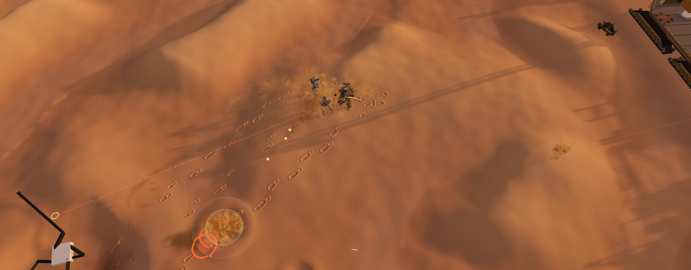

# Report 2026-11-06T22-17-40-convoy

http://localhost:4173/labs/convoy/?siege&manual&noworker

- Lab: convoy
- About: {"selected":null,"topic":null,"mech":"walking","pilot":"in on the sand","crane":"","convoyS":77,"expedition":"out","fuel":840,"home":27,"atRisk":34,"banked":2223}
- URL: http://localhost:4173/labs/convoy/?siege&manual&noworker
- Camera: {"position":[100.83,71.78,3.57],"fov":40}



## HUD

```
20.0 ms avg · 28.1 worst · 50 fps
sim 9.3 · submit 8.8 · gpu/wait 1.9 ms
WebGPU · 577 draws · 2162k tris
cpu ms: summons 1.75 · ground dents 1.68 · plough patch 0.97 · craters 0.69 · swarm camps 0.65 · radar draw 0.56 · escorts 0.55 · turrets 0.47 · convoy bodies 0.36 · mech 0.24 · trail 0.24 · convoy 0.23 · gun fx 0.17 · fire 0.16 · ground 0.16 · POIs and salvage 0.15 · raiders and fights 0.14 · packs and raids 0.14 · deaths 0.14 · loot 0.10 · expedition hud 0.09 · radar lists 0.06 · shots 0.05 · extraction pads 0.05 · blast waves 0.04 · light 0.04 · register 0.03 · camera 0.03 · pilot 0.02 · dents 0.02 · dust 0.02 · contracts 0.01 · simworker 0.00 · way home 0.00
shaders: shaders: 136 pipelines built (in the background), 717 ms in frames (code 703), worst frame 14 ms
shadow batches: shadow batches: 1563 of 1680 parts cast through 2 batches (145 handed back)
uploads: instance uploads trimmed: 35 buffers, 856 KB a frame not sent; 66 empty pools not drawn
summons: drones 0/0 up · 0 attacking · rounds 0 · lost 0 · companions 0/0 · scrappers 0/0 · home · lost 0 · replicas 2/2 (1 minigun, 1 rockets)
weapons: LMB sword (hand) click to cut, again to cut back; double click: vertical cut; Space mid-cut: power cut · RMB sword (hand) click to cut, again to cut back; double click: vertical cut; Space mid-cut: power cut · 1 rocket launcher 2/2 ready · 2 line mortar ready
expedition: expedition out 35 s · fuel off · home 27 s (front crane) · radar convoy 2550 m · POIs built 15 · camps & packs on the field 3, robots 16 (0 awake), crushers 8 (0 swarms called) · raiders: bandit camps 9 (193 up, 0 alert), war bands 0 (0 vehicles), columns 12 · fortresses 0 (0 up, gates 0/0 down) · hubs 0 (fabricators 0/0 up) · fights: 0 engaged in view, 2 off view, 6 resolved · packs 4 (1 hunting), raids 0, next raid 37 s, first fight had · banked 0, recalled 0, fuel 0, lost 0, pilot killed 0 · pads 21 within 3 km, pickup idle, bank 2223, unlocks crane2 pickup1 radar2
contracts: contracts 0 active, 1 offered (next 73 s) · lairs known 0
deaths: bodies 17 (2 moving) · craters 122
airlift: airlift: idle · 0 m flown, 0 scrap this trip · quadcopter at 0, 0, 0
convoy: convoy 2.2 m/s heading 5° · 6 cars over 230 m · 5 footbridges · 12 escorts · pipe runs 49 · ruts 1090 · road 80 points · ground chunks pending 0
plough: plough: cut 23 m² at the blade · moving 9 / 0 m³/s left / right (load 6% / 0%) · patched 0 vertices in 0.00 ms, 0 boxes waiting · wake stations 265
mech: mech: walking · 96 m from the crane (range 21)
dash: dash ●○○○ (Space) · hold Space to sprint · hull 10001/10233.963066625893 · ammo L 1 R 1 · hits body 22, legs 5, feet 4
crane: crane: Mech bay · stowed · slew -180° · reach 9.0 m · rope 1.2 m · swing 0.00 m · picked up 0, launched 0, parked 0
spikes (frames over 33 ms, newest last):
  t 26.9 s: 39.1 ms (sim 25.3, submit 10.8) · ground 4.5, ground dents 3.7, summons 3.1, deaths 2.5
  t 26.9 s: 37.8 ms (sim 22.7, submit 9.9) · ground 4.4, ground dents 3.8, summons 2.7, deaths 2.6
  t 26.9 s: 34.4 ms (sim 23.5, submit 9.9) · ground 4.2, ground dents 3.9, summons 2.5, deaths 2.5
  t 27 s: 35.8 ms (sim 24.2, submit 9.7) · ground 4.4, ground dents 3.9, summons 2.7, deaths 2.4
  t 27 s: 35.7 ms (sim 23.5, submit 9.8) · ground 4.4, ground dents 3.8, summons 2.7, deaths 2.2
  t 27 s: 34.9 ms (sim 25.2, submit 9.9) · ground 4.4, ground dents 3.8, deaths 3.3, summons 2.7
  t 27.1 s: 36.7 ms (sim 24.7, submit 9.8) · ground 4.3, ground dents 3.8, summons 2.6, deaths 2.2
  t 27.1 s: 36.2 ms (sim 22.4, submit 9.9) · ground 4.3, ground dents 3.8, summons 2.6, deaths 2.3
  t 27.1 s: 34.2 ms (sim 23.1, submit 9.9) · ground 4.4, ground dents 3.9, summons 3.1, deaths 2.2
  t 27.2 s: 34.7 ms (sim 24.5, submit 11) · ground 4.4, ground dents 3.8, summons 2.6, deaths 2.2
  t 27.2 s: 37.2 ms (sim 27, submit 10.3) · deaths 4.9, ground 4.3, ground dents 3.9, summons 2.6
  t 27.3 s: 39.1 ms (sim 21.4, submit 9.5) · ground 4.4, ground dents 3.7, deaths 3.2, summons 2.5
  t 29.2 s: 81.8 ms (sim 48.8, submit 11.1) · dents 25.0, craters 4.6, ground dents 3.9, summons 2.8
  t 29.2 s: 61.8 ms (sim 17, submit 10.4) · ground dents 3.8, deaths 2.8, summons 2.4, swarm camps 1.5
  t 32.1 s: 39.3 ms (sim 28.2, submit 9.3) · dents 11.7, ground dents 3.9, craters 2.6, summons 2.6
  t 32.1 s: 40 ms (sim 14.1, submit 8.7) · ground dents 4.0, summons 2.5, radar draw 1.0, escorts 0.9
  t 37.5 s: 52.4 ms (sim 17.7, submit 8.6) · ground dents 3.9, turrets 2.9, summons 2.7, radar draw 1.2
  t 37.6 s: 42.4 ms (sim 15.6, submit 7.9) · summons 3.0, convoy bodies 2.6, turrets 2.0, craters 1.4
  t 37.8 s: 50 ms (sim 11.7, submit 8.2) · summons 1.8, craters 1.6, ground dents 1.2, escorts 1.1
  t 38.4 s: 39.3 ms (sim 8.7, submit 8.6) · summons 1.8, radar draw 1.0, trail 0.7, turrets 0.7
```

## Tuning values

```json
{
 "droneCount": 0,
 "droneOrbitR": 6.5,
 "droneOrbitH": 5.5,
 "droneOrbitSpin": 35,
 "droneSpeed": 24,
 "droneAccel": 45,
 "droneGain": 2.6,
 "droneBob": 0.25,
 "droneEngage": 34,
 "droneLeash": 45,
 "droneStrafeR": 8,
 "droneStrafeH": 4.5,
 "droneStrafeSpin": 60,
 "droneRange": 24,
 "droneRate": 6,
 "droneBurst": 6,
 "dronePause": 0.7,
 "droneDamage": 5,
 "droneSpread": 2.5,
 "droneHp": 40,
 "droneRebuild": 6,
 "droneSize": 1.1,
 "droneStrikeTime": 6,
 "droneStrikeCool": 18,
 "droneStrikeRate": 2,
 "compCount": 0,
 "compHp": 1400,
 "compSize": 3.2,
 "compSpeed": 7.5,
 "compNear": 9,
 "compFar": 18,
 "compEngage": 32,
 "compLeash": 42,
 "compSide": 7,
 "compBack": 3,
 "compRebuild": 25,
 "compMiniDamage": 8,
 "compMiniPause": 1.4,
 "compRocketDamage": 30,
 "compRocketPause": 2.5,
 "swarmCount": 0,
 "swarmHp": 20,
 "swarmSpeed": 40,
 "swarmBite": 3,
 "swarmRebuild": 3,
 "swarmGuard": 12,
 "swarmHome": 4,
 "swarmSendRange": 70,
 "swarmHunt": 16,
 "swarmSendTime": 25,
 "swarmClear": 3,
 "keepUp": 1.25,
 "compTopSpeed": 20,
 "allyAggro": 14,
 "allyAggroShare": 0.6,
 "repCount": 2,
 "repHull": 2200,
 "repArmour": 4,
 "repDamage": 0.6,
 "repEngage": 40,
 "repHold": 18,
 "repLeash": 45,
 "repSide": 9,
 "repBack": 2,
 "repCatchUp": 12,
 "repRebuild": 20.107552224951913,
 "repBuild": 6.606955843000877,
 "repHitSize": 0.9,
 "repBodySize": 1.1,
 "repRocketShare": 0.5,
 "repRocketDamage": 30,
 "repRocketVolley": 4,
 "repRocketRate": 0.18,
 "repRocketPause": 3,
 "repRocketRadius": 2.5,
 "repRocketArc": 3,
 "repRocketSpeed": 26,
 "repRocketScatter": 2,
 "repLegThin": 0.55,
 "repFootSize": 0.8,
 "repHullW": 0.62,
 "repHullH": 0.8,
 "repHullL": 0.85,
 "repGunSize": 0.72,
 "repShade": 0.55,
 "sumLinger": 15,
 "summonAggro": 22,
 "summonLure": 0.8,
 "sinkSand": 0.175,
 "sinkSnow": 0.22,
 "sinkDirt": 0.04,
 "sinkGravel": 0.025,
 "sinkRock": 0,
 "hover": 0,
 "hoverLift": 0.7,
 "hoverBob": 0.12,
 "hoverBobRate": 0.35,
 "hoverSpring": 10,
 "hoverDamp": 4,
 "hoverFall": 0.6,
 "hoverClimb": 35,
 "hoverLook": 0.45,
 "hoverAccel": 11,
 "hoverResponse": 2.2,
 "hoverCoast": 3,
 "hoverBoostAccel": 14,
 "hoverDash": 17,
 "hoverDashTime": 0.4,
 "hoverTurn": 160,
 "hoverTilt": 1.6,
 "hoverTiltMax": 14,
 "hoverTiltEase": 5,
 "hoverTuck": 0.62,
 "hoverSpread": 0.75,
 "hoverTrail": 0.07,
 "hoverFootLag": 6,
 "hoverToe": 30,
 "hoverSway": 0.12,
 "hoverDust": 0.35,
 "hoverDustRate": 14,
 "hoverDustReach": 3,
 "walkSpeed": 7.1854117799280095,
 "sprintSpeed": 9.571159770447299,
 "accel": 4.157930110127833,
 "turnRate": 138.29575163930656,
 "walkAccel": 30,
 "walkStop": 40,
 "walkWeight": 0.5,
 "legTurnRate": 180,
 "backArc": 125,
 "backSpeed": 0.9,
 "turnSlow": 0,
 "crossHurry": 4,
 "turnHurry": 2,
 "overBrake": 6,
 "gripFullOver": 0,
 "gripCurve": 2,
 "gripLetGoOver": 0,
 "strideBase": 2.3,
 "stridePerSpeed": 1.4687586013097318,
 "strideMax": 7.05,
 "duty": 0.64,
 "dutyFast": 0.54,
 "stanceBack": 0.3,
 "moveLean": 4,
 "liftHeight": 0.4,
 "liftHold": 0,
 "liftBox": 0,
 "stomp": 1,
 "stompShare": 0.35,
 "rollOff": 70,
 "rollStart": 0.4,
 "swingCurl": 30,
 "footClear": 0.3,
 "hipHeight": 3.049999952316284,
 "hipWidth": 0.7799999713897705,
 "footSpread": 0.97,
 "walkSpread": 0.66,
 "toeOut": 6,
 "kneeOut": 6,
 "bob": 0.06,
 "runBounce": 1,
 "runCrouch": 0.18,
 "impact": 2.2,
 "weightShift": 0.08,
 "crunchRoll": 4,
 "shoulderLevel": 0.8,
 "speedLean": 1.5,
 "leanPerAccel": 0.14,
 "leanMax": 10,
 "leanInDash": 0.6,
 "leanStiff": 260,
 "leanDamp": 0.6,
 "leanSmooth": 0.02,
 "leanCrouch": 0.1,
 "leanShift": 0.25,
 "slopePitch": 0.35,
 "footTiltMax": 28,
 "downhillReach": 0.55,
 "climbSink": 0,
 "thighFold": 300,
 "thighSplay": 90,
 "uphillSlow": 0.35,
 "downhillPlant": 0.2,
 "downhillCrouch": 0.3,
 "downhillSitBack": 0,
 "downhillLevel": 0.25,
 "femur": 1.7171487636796257,
 "shin": 0.748732256949777,
 "cannon": 1.0831002710444873,
 "cannonRake": 22.344014025427512,
 "swingTuck": 45,
 "hockExtend": 0.8,
 "hockCompress": 3,
 "hockMinSlow": 18,
 "hockMinFast": 3,
 "kneeMaxPlanted": 165,
 "toeClear": 0.1,
 "ankleHeight": 0.1525000035762787,
 "ankleBack": 0,
 "toeHinge": 0.14,
 "toeLength": 0.85,
 "toeCurl": 40,
 "leaveG": 1.2,
 "leaveMin": 5,
 "airTuck": 0.72,
 "airReach": 0.97,
 "airFore": 0.35,
 "airSplit": 0.7,
 "airSpread": 1.15,
 "airFold": 25,
 "airPitch": 0.3,
 "airSteer": 0.25,
 "airGravity": 1.4,
 "landSoft": 3,
 "landDip": 0.12,
 "landSquat": 0.14,
 "landSquatMax": 1,
 "landRecover": 0.6,
 "landOvershoot": 0.12,
 "landPitch": 10,
 "landHard": 10,
 "landStagger": 0.2,
 "landHurt": 11,
 "landDamage": 40,
 "landFriction": 3,
 "landShake": 0.5,
 "knockTake": 0.8,
 "knockGrip": 25,
 "wallGrade": 0.9,
 "wallStop": 1.6,
 "wallScrub": 14,
 "launchUpMax": 6,
 "boundTop": 16,
 "boundBuild": 0.3,
 "boundHop": 6,
 "boundStanceLen": 4,
 "boundStagger": 0.3,
 "boundReach": 0.6,
 "boundSplit": 1.6,
 "boundSwing": 14.5,
 "boundLeadLift": 0.24,
 "boundTuck": 0.8,
 "boundCrouch": 1,
 "boundSquat": 0.41,
 "boundLean": 0,
 "boundGrip": 0.7,
 "boundYaw": 0.6,
 "boundDriftMax": 22,
 "boundSkid": 0.5,
 "boundAbsorb": 7,
 "turnRoll": 1,
 "turnRollMax": 30,
 "turnRollEase": 1,
 "turnLeanShift": 0.5,
 "boundGallop": 0,
 "runSteps": 1.8,
 "runStepsTop": 3,
 "runPlant": 0.5,
 "runBlend": 0.6,
 "runBob": 0.175,
 "runThud": 0.11,
 "runThighUp": 50,
 "runShinBack": 100,
 "runHockFold": 45,
 "runTuckAt": 0.5,
 "runFollow": 0.45,
 "runPaw": 0.8,
 "runFootDrop": 55,
 "runToeCurl": 100,
 "runHockExtend": 1,
 "runRollOff": 85,
 "runRollStart": 0.12,
 "runLookAhead": 0.53,
 "runClear": 2.8,
 "runClimbSteps": 0.04,
 "runPlantDrop": 0.12,
 "runPlantPitch": 3,
 "runPushRise": 0.05,
 "runDescentSteps": 0,
 "runHurry": 0.3,
 "runReachGive": 0.1,
 "legReachMax": 0.93,
 "swingThighFold": 160,
 "swingFoldFrom": 0.12,
 "uphillLead": 1,
 "legRoomKnee": 35,
 "legRoomHock": 35,
 "legRoomForward": 20,
 "legTurnMax": 2000,
 "dashLoad": 0.02,
 "dashUnweight": 0.05,
 "dashDip": 0.3,
 "dashPush": 0.06,
 "dashOverlap": 0.01,
 "dashThrough": 0.1,
 "dashPushAngle": 70,
 "dashPreTurn": 45,
 "dashEdge": 22,
 "dashKnee": 0.55,
 "dashStepOut": 0.9,
 "dashThroughLift": 0.45,
 "dashLeanSide": 22,
 "dashSpeedOut": 20,
 "dashRise": 0.045,
 "dashHold": 0.28,
 "dashStop": 0.1,
 "dashBend": 12,
 "dashBrake": 80,
 "dashPedalSteps": 0,
 "dashPedalFrom": 2,
 "dashPedalStep": 0.16,
 "dashPedalSpeed": 5,
 "dashPedalBrake": 70,
 "dashPedalGrip": 5,
 "dashPedalReach": 0.6,
 "dashPedalLift": 0.25,
 "dashStomp": 1.6,
 "dashForwardMax": 35,
 "dashCutMin": 125,
 "dashCutSlow": 1.25,
 "dashSpreadMax": 2.6,
 "dashIntoRun": 27,
 "idleAfter": 10,
 "idleEvery": 18,
 "idleJitter": 0.6,
 "idleSteps": 4,
 "idleRate": 0.55,
 "idleLift": 0.4,
 "idleClear": 0.09,
 "idleEase": 0.97,
 "idleRoll": 3,
 "idleRollStart": 0.2,
 "idleCurl": 30,
 "idleToes": 40,
 "torsoTurnRate": 150,
 "torsoLimit": 180,
 "podYawMax": 30,
 "podPitchMax": 20,
 "podPitchUp": 50,
 "torsoLeanMax": 12,
 "torsoLeanRate": 40,
 "podTrack": 12,
 "spinUp": 0.8,
 "spinDown": 1.4,
 "spinRpm": 900,
 "fireFrom": 0.65,
 "fireRate": 1.1695253168651958,
 "spread": 3,
 "range": 45,
 "recoil": 0.03,
 "recoilReturn": 9,
 "recoilMax": 0.14,
 "torsoKick": 0.25,
 "outwardTrack": 0.55,
 "spinSplit": 0.15,
 "rateSplit": 0.06,
 "fireCone": 4,
 "gunSpacing": 1.02,
 "heldTrack": 1.8,
 "heldOutward": 0.9,
 "runArmOut": 170,
 "runArmIn": 50,
 "armUpper": 1.45,
 "armFore": 1.45,
 "armReachFront": 0.55,
 "armReachSide": 0.98,
 "armStraightAt": 95,
 "armDropFront": 0.9,
 "armDropSide": 0.1,
 "armPoleOut": 0.8,
 "armPoleBack": 0.6,
 "armShoulderOut": 0.35,
 "armCrossIn": 0.6,
 "armAlign": 0.75,
 "armRollFrom": 90,
 "armRollOver": 45,
 "armRollWrist": 180,
 "armReachBack": 0.7,
 "armDropBack": 0,
 "armPoleUp": 4,
 "armAlignBack": 0.2,
 "armRollLean": 8,
 "armKickMinigun": 3,
 "shotPullBack": 4,
 "armKickRifle": 4,
 "armKickSmg": 0.3,
 "armKickOther": 2.5,
 "minigunGripBack": 0.55,
 "smgScale": 1.4,
 "ammoPerGun": 1,
 "reloadTime": 0,
 "tracerSpeed": 220,
 "tracerLength": 1.2,
 "tracerEvery": 1,
 "tracerFill": 2,
 "flashSize": 1,
 "flashLight": 40,
 "hitDust": 2.1,
 "casingKick": 1.5,
 "sandGrit": 5,
 "metalSparks": 9,
 "metalSparkSpeed": 11,
 "metalSmoke": 1,
 "sparkSize": 2.5,
 "fxBudget": 1,
 "fxNear": 15,
 "fxThinFrom": 30,
 "fxThinTo": 90,
 "fxFarKeep": 0.3,
 "fxAllyKeep": 0.7,
 "fxDustPerFrame": 400,
 "fxGpuDustPerFrame": 1600,
 "fxLiveShare": 0.85,
 "fxTrimSpan": 1.5,
 "fxMergeCell": 1.5,
 "fxMergeSize": 0.25,
 "fxMergeCount": 0.5,
 "fxUnderFireNear": 6,
 "fxUnderFireDust": 0.25,
 "fxUnderFireBlast": 0.35,
 "fxGpuBits": 1,
 "fxGpuTracers": 1,
 "fxGpuDust": 1,
 "fxGpuDustPool": 32768,
 "masterVolume": 0.35,
 "spitLevel": 0.05,
 "growlLevel": 1.22,
 "spinLevel": 0.375,
 "brapLevel": 0.19,
 "dirtLevel": 0.32,
 "metalLevel": 0.3,
 "metalEvery": 0.05,
 "metalScatter": 0.03,
 "casingLevel": 0.18,
 "grindLevel": 0.3,
 "growlDetune": 1.7,
 "celShading": 0,
 "inkWidth": 0,
 "paintRoughness": 0.55,
 "paintMetal": 0.05,
 "shadeFloor": 0.42,
 "shadeMid": 0.72,
 "camPitch": 50,
 "camDist": 40,
 "camNearPitch": 45,
 "camNearDist": 12,
 "camFarPitch": 55,
 "camFarDist": 80,
 "camFollow": 6,
 "camYaw": 0,
 "camFov": 40,
 "camSouth": 0.12,
 "camLead": 0.6,
 "camLeadMax": 14,
 "camLeadFrom": 7,
 "camSpeedZoom": 1.2,
 "camSpeedEase": 1.5,
 "seed": 7,
 "windAngle": 25,
 "spacing": 44,
 "height": 14,
 "slip": 0.24,
 "flats": 0.25,
 "meander": 0.7,
 "warp": 0.45,
 "breakup": 0.85,
 "cross": 0.55,
 "variety": 0.6,
 "swell": 5,
 "swellScale": 420,
 "bumps": 0.25,
 "crestSoft": 0.06,
 "chunkSize": 64,
 "segments": 64,
 "radius": 5,
 "budgetMs": 4,
 "facets": 0,
 "sandGrain": 0.5,
 "sandSpecks": 0.45,
 "sandRipples": 0.25,
 "shadowTerrain": 1,
 "shadowSpacing": 4,
 "shadowSink": 0.3,
 "workerBuilds": 8,
 "sunAzimuth": 215,
 "sunElevation": 15,
 "sunIntensity": 3.2,
 "envIntensity": 0.5,
 "skyFill": 0,
 "exposure": 1,
 "toneMap": 0,
 "haze": 0.5,
 "shadowBox": 50,
 "shadowSoft": 1.7,
 "dayCycle": 1,
 "dayRun": 1,
 "timeOfDay": 16.704,
 "dayLength": 20,
 "nightShare": 0.35,
 "shadowMinEl": 13,
 "lowShadow": 0.55,
 "lowSoft": 1.8,
 "lowSunFill": 0.4,
 "handoverEl": -2,
 "blueHour": 4,
 "moonEl": 50,
 "moonAz": 140,
 "moonDrift": 30,
 "moonStrength": 0.18,
 "moonShadow": 0.7,
 "nightExposure": 1.4,
 "nightFill": 0.3,
 "stars": 1,
 "nightLightCap": 8,
 "nightSpotCap": 4,
 "lampStrength": 22,
 "lampRange": 14,
 "headlamp": 1,
 "headlampStrength": 220,
 "headlampRange": 50,
 "headlampAngle": 30,
 "headlampDip": 24,
 "headlampShadow": 1,
 "headlampShadowMap": 1024,
 "headlampShadowNear": 0.6,
 "headlampBeam": 0.06,
 "blastLight": 2600,
 "blastLightTime": 0.6,
 "nightLightsFrom": 0.15,
 "lightFar": 160,
 "clusterRadius": 8,
 "clusterCurve": 0.65,
 "clusterCap": 12000,
 "clusterGrow": 0.6,
 "flashPool": 1.2,
 "dayFlash": 0,
 "rocketLight": 420,
 "rocketRange": 22,
 "rocketHue": 30,
 "rocketGlow": 1.6,
 "rocketFlare": 0.45,
 "rocketPool": 1.1,
 "muzzleLight": 500,
 "muzzleTime": 0.1,
 "enemyHue": 18,
 "enemyLight": 1.2,
 "robotFireHue": 354,
 "robotFireLight": 1.3,
 "gunFlashLight": 180,
 "gunFlashTime": 0.07,
 "teleLight": 260,
 "telePool": 0.55,
 "teleRamp": 2,
 "telePrio": 1.5,
 "tracerShare": 1,
 "tracerLight": 320,
 "tracerSplit": 3,
 "tracerPower": 0.6,
 "tracerRef": 12,
 "tracerRange": 9,
 "tracerGlow": 0.9,
 "railLight": 2400,
 "streamOn": 1,
 "streamRef": 160,
 "streamCurve": 0.45,
 "streamMax": 2.5,
 "streamCore": 1.1,
 "streamCoreWidth": 0.4,
 "streamDay": 0.2,
 "streamGround": 0.45,
 "streamGroundWidth": 1.6,
 "streamPoints": 2,
 "streamLight": 360,
 "streamRange": 10,
 "streamHue": 30,
 "streamTau": 0.18,
 "streamPulseTau": 0.1,
 "vehReach": 16,
 "vehAngle": 16,
 "vehGlow": 0.9,
 "vehPool": 0.25,
 "vehBeam": 0.05,
 "vehReal": 160,
 "tailGlow": 0.45,
 "robotReach": 9,
 "robotAngle": 16,
 "robotSweep": 35,
 "robotScanHold": 0.9,
 "robotScanSnap": 0.12,
 "robotScanOvershoot": 1.6,
 "robotScanNear": 0.25,
 "robotSmallGlow": 0.55,
 "robotSmallIdle": 0.6,
 "robotSmallPulse": 0.25,
 "robotSmallPulseRate": 0.7,
 "robotGlow": 0.45,
 "robotPool": 0.2,
 "robotBeam": 0.06,
 "robotReal": 150,
 "robotSquare": 0,
 "robotScanLine": 0.9,
 "robotScanRate": 0.8,
 "floodAngle": 38,
 "floodGlow": 1.3,
 "floodPool": 0.22,
 "floodBeam": 0.04,
 "floodReal": 220,
 "runningGlow": 0.5,
 "runningGap": 4,
 "cabGlow": 1.1,
 "cabReal": 25,
 "waveOn": 1,
 "waveSize": 1,
 "waveMinSize": 1,
 "waveLife": 0.45,
 "waveStrength": 1.5,
 "waveThick": 0.5,
 "waveEase": 2.2,
 "waveRim": 0.25,
 "waveRing2": 0.5,
 "waveRing2Slow": 0.55,
 "waveHeat": 1.4,
 "waveHeatStrength": 0.08,
 "waveGroundSize": 1.3,
 "waveGroundLife": 0.3,
 "waveGroundLight": 1,
 "waveMergeDist": 0.8,
 "waveMergeTime": 0.12,
 "waveMergeGrow": 0.35,
 "waveMergeCap": 2.5,
 "waveMax": 24,
 "waveClear": 3.5,
 "waveClearHeight": 2.2,
 "waveClearSoft": 0.5,
 "wavePerFrame": 6,
 "waveTrail": 1,
 "waveTrailStrength": 0.05,
 "waveTrailSize": 1.1,
 "waveTrailLife": 0.35,
 "waveTrailRate": 18,
 "waveHeatMax": 64,
 "waveBeamHeat": 0.1,
 "waveDefaultK": 1,
 "waveRocketK": 1,
 "waveMissileK": 1,
 "waveLineK": 1,
 "waveMortarK": 1,
 "waveCannonK": 1,
 "waveTurretK": 1,
 "waveVolleyK": 1,
 "waveBeamK": 1,
 "waveDeathK": 1,
 "novaOn": 1,
 "novaLife": 1.3,
 "novaFlash": 0.35,
 "novaShell": 0.85,
 "novaRing": 1.8,
 "novaRingSharp": 14,
 "novaGround": 1.1,
 "novaBright": 1.6,
 "novaLight": 2.2,
 "heatOn": 1,
 "heatArea": 104,
 "heatRes": 256,
 "heatCool": 0.15,
 "heatRise": 0.4,
 "heatSpread": 1,
 "heatGlowFrom": 480,
 "heatGlow": 1,
 "heatFlicker": 0.35,
 "heatChar": 0.8,
 "heatCharFrom": 950,
 "heatCharLife": 90,
 "heatScorchW": 2.2,
 "heatScorch": 0.85,
 "heatPulse": 1300,
 "heatDeath": 1500,
 "heatSlam": 1200,
 "heatBeam": 1700,
 "heatStrider": 2100,
 "heatRail": 1150,
 "heatIgnited": 780,
 "heatBlast": 560,
 "heatLight": 90,
 "heatLights": 6,
 "heatLightBin": 6,
 "heatLightPrio": 0.7,
 "dustWindAngle": 70,
 "windSpeed": 1.4,
 "cloudLife": 5,
 "cloudGrow": 3.5,
 "cloudRise": 0.35,
 "cloudDrag": 1.4,
 "cloudDensity": 0.65,
 "turbulence": 0.5,
 "clumpLife": 1.3,
 "clumpDensity": 0.85,
 "clumpDrag": 3.2,
 "stompCloud": 1,
 "stompClump": 1,
 "stompSize": 0.8,
 "stompSpeed": 2,
 "kickCloud": 3,
 "kickClump": 5,
 "kickSize": 0.7,
 "kickSpeed": 3,
 "sprintKick": 1.8,
 "hitCloud": 2,
 "hitClump": 4,
 "hitSize": 0.45,
 "hitCarry": 5,
 "plumePuffs": 6,
 "plumeSpeed": 7,
 "plumeLean": 0.55,
 "plumeSpread": 0.22,
 "plumeSize": 0.3,
 "plumeDensity": 0.85,
 "plumeDrag": 2.6,
 "sprayCount": 10,
 "spraySpeed": 11,
 "spraySize": 0.12,
 "sprayLean": 0.7,
 "windIn": 1.2,
 "wheelDust": 0.9,
 "wheelClump": 0.5,
 "slideDust": 1.2,
 "slideClump": 2.2,
 "slideThrow": 0.6,
 "slideMin": 1.5,
 "stepPush": 0.7,
 "gravelDust": 0.25,
 "gravelClump": 0.35,
 "dirtDust": 0.3,
 "dirtClump": 0.7,
 "concreteDust": 0,
 "concreteClump": 0,
 "dustBright": 1,
 "dustShade": 0.85,
 "edgeFray": 0.7,
 "billow": 0.7,
 "inShadow": 0.6,
 "dustShadowBlur": 0.6,
 "grain": 0.35,
 "softDistance": 1.2,
 "shadowStrength": 0.45,
 "shadowSize": 1.1,
 "dustCullMargin": 15,
 "dustGroundRefresh": 1.5,
 "dustGroundEvery": 30,
 "dustSunEvery": 8,
 "dentCoverage": 100,
 "dentRes": 2048,
 "patchSpacing": 0.25,
 "patchEdge": 4,
 "patchBudget": 3,
 "patchLead": 6,
 "patchFineArea": 32,
 "patchFineSub": 2,
 "dentScale": 1,
 "dentPrint": 0.1,
 "dentRut": 0.06,
 "dentRutWidth": 1,
 "dentFurrow": 0.12,
 "dentRound": 0.05,
 "dentRoundEvery": 1,
 "dentHitDepth": 0.06,
 "dentHitSize": 0.15,
 "dentHitOpen": 1,
 "dentHitLength": 4,
 "dentHitAngle": 1,
 "dentBlast": 0.14,
 "dentComp": 0.6,
 "dentDark": 0.22,
 "dentRough": 0.6,
 "dentMaxDepth": 0.6,
 "dentRelaxStep": 0.3,
 "printSize": 1,
 "printShaped": 1,
 "printWall": 0.14,
 "printSpread": 0.36,
 "dentMemory": 6000,
 "dentMemoryRange": 250,
 "dentMemoryLife": 1,
 "printContact": 0.12,
 "printRobots": 2,
 "printBigDepth": 1.2,
 "printMidDepth": 0.45,
 "craterSize": 0.35,
 "slideOnSlope": 1,
 "dentSandDepth": 1,
 "dentSandBerm": 1,
 "dentSandSoften": 6,
 "dentSandSlump": 0.5,
 "dentSandLife": 90,
 "dentDirtDepth": 0.45,
 "dentDirtBerm": 0.5,
 "dentDirtSoften": 1.5,
 "dentDirtSlump": 0.1,
 "dentDirtLife": 400,
 "dentGravelDepth": 0.3,
 "dentGravelBerm": 0.6,
 "dentGravelSoften": 2,
 "dentGravelSlump": 0.1,
 "dentGravelLife": 300,
 "dentSnowDepth": 2.5,
 "dentSnowBerm": 0.35,
 "dentSnowSoften": 1,
 "dentSnowSlump": 0.02,
 "dentSnowLife": 900,
 "dashDistance": 14,
 "dashTime": 1.05,
 "dashPushShare": 0.44,
 "dashCharges": 4,
 "dashRecharge": 1.9709944271659412,
 "dashGap": 0.25,
 "dashRegenDelay": 0.8,
 "sprintDrain": 0.25,
 "dashCrouch": 1.2,
 "dashLean": 25,
 "dashShoveRadius": 4,
 "dashShove": 5,
 "dashShoveDamage": 6,
 "dashDamageCut": 0.5,
 "dashSlope": 1.5,
 "slideFriction": 5,
 "dashCarry": 4,
 "slideMax": 16,
 "boostFuel": 0,
 "boostRegen": 0.35,
 "reactorCap": 4,
 "reactorRegen": 0.4,
 "reactorBusy": 0.25,
 "reactorDelay": 0.6,
 "mechWreckOn": 1,
 "mechPoseStiffness": 1.5,
 "mechPoseDamping": 0.3,
 "mechBendLimit": 70,
 "mechHoldFor": 0.8,
 "mechHoldEnd": 0.35,
 "mechFadeTime": 1.6,
 "mechDeathPush": 2.5,
 "mechDeathLift": 0.15,
 "mechDeathSpin": 0.25,
 "mechDeathSide": 0.5,
 "mechMomentum": 1,
 "mechWreckDamping": 1.2,
 "mechMoveFor": 12,
 "mechThud": 1,
 "headTurnRate": 260,
 "headYawMax": 75,
 "headPitchUp": 25,
 "headPitchDown": 35,
 "headLag": 0.09,
 "headSettle": 0.7,
 "headLead": 0.5,
 "headLookAhead": 0.3,
 "headLookAheadMax": 30,
 "headScanWidth": 40,
 "headScanPeriod": 7,
 "headScanAfter": 1.2,
 "clusterSweep": 1,
 "headSize": 0.33,
 "headDrop": 0.12,
 "headForward": 0.25,
 "boundTap": 0.2,
 "boostTop": 8,
 "boostGlide": 0,
 "boostBurn": 0.25,
 "sprintGunsAfter": 0,
 "sprintFaceDrift": 0.5,
 "sprintHullLean": 8,
 "airGunSpread": 3,
 "sprintPushDust": 0.8,
 "sprintToeDig": 1.2,
 "sprintShake": 0.05,
 "sprintThump": 0.35,
 "boundDust": 0.5,
 "trampleReach": 3,
 "trampleDown": 2.5,
 "trampleFrom": 3,
 "trampleFull": 11,
 "trampleDamage": 15,
 "trampleCurve": 2,
 "trampleThrow": 0.7,
 "trampleThrowMin": 2.5,
 "chargeSpeed": 9,
 "chargeLook": 1.2,
 "ramMechMass": 40,
 "ramBounce": 0.2,
 "ramFrom": 2,
 "ramDamage": 15,
 "ramMechShare": 1,
 "solidsOn": 1,
 "bodyRadius": 2.4,
 "mechShove": 0.3,
 "softNudge": 8,
 "kitMax": 3,
 "kitShare": 0.35,
 "kitTime": 2,
 "kitLockout": 1,
 "kitHandTime": 4,
 "kitHandReach": 4,
 "kitPrice": 40,
 "kitSalvage": 0.12,
 "kitSound": 0.8,
 "healSelf": 0.6,
 "zoneStack": 2,
 "beaconRate": 0.02,
 "beaconTime": 10,
 "beaconRadius": 8,
 "beaconRange": 20,
 "beaconCooldown": 30,
 "naniteRate": 0.03,
 "naniteTime": 6,
 "naniteRadius": 6,
 "naniteCooldown": 25,
 "weldRate": 0.05,
 "weldTime": 4,
 "weldCut": 0.4,
 "weldCooldown": 35,
 "trample": 1.0832485905326903,
 "crush": 1.0807171435635536,
 "hull": 10233.963066625893,
 "armour": 16.225212593676524,
 "roundDamage": 461.6687946036458,
 "roundAp": 0.1,
 "roundPierce": 2,
 "roundPen": 1,
 "roundPenCurve": 1.75,
 "roundSheetHalf": 0.35,
 "roundSheetHeight": 17,
 "roundLine": 0.5,
 "roundSplash": 1.6,
 "roundSplashShare": 0.5,
 "hitRadius": 1.7,
 "respawn": 4,
 "convoySpeed": 2.2,
 "convoyHeading": 0,
 "convoyTurn": 1.33,
 "convoyWander": 12,
 "convoyWanderLength": 600,
 "routeHalfWidth": 11,
 "routeBlend": 12,
 "routeAhead": 150,
 "routeLift": 3,
 "routeRough": 0.3,
 "ploughGap": 12,
 "bladeSweep": 24,
 "bladeRamp": 4,
 "bermGrow": 8,
 "bermSpread": 2.2,
 "bermOut": 2,
 "bermCurve": 0.6,
 "bermLumps": 0.35,
 "bermCarry": 6,
 "ploughPatchEvery": 3,
 "convoyDeckHeight": 3.2,
 "convoyBayDeck": 3.6,
 "convoySpringHz": 0.7,
 "convoyDamping": 0.7,
 "convoyTrackSprings": 1.6,
 "convoyPush": 1,
 "craneJib": 22,
 "craneMast": 3,
 "craneMount": 11,
 "craneReach": 21.5,
 "craneMinReach": 4,
 "craneSlew": 108,
 "craneSlewAccel": 72,
 "craneLuff": 54,
 "craneLuffAccel": 72,
 "craneHoist": 12.6,
 "craneHoistAccel": 14.4,
 "craneRopeDamping": 0.5,
 "craneSwing": 0.3,
 "craneSteady": 1.5,
 "craneRange": 21,
 "craneDwell": 0.4,
 "craneGrip": 1.7,
 "craneGripTol": 1.2,
 "craneClear": 1.5,
 "craneDeployReach": 13,
 "craneFollow": 2,
 "craneCarryTurn": 25,
 "craneLaunchDwell": 0.4,
 "craneDropHeight": 3,
 "craneDropSteady": 0.35,
 "craneLandShake": 0.5,
 "craneHover": 0.8,
 "craneSwingLean": 0.6,
 "deckParkTime": 0.8,
 "deckRiseTime": 1,
 "deckCrouch": 0.85,
 "deckParkPitch": 6,
 "heliOn": 1,
 "heliPadZ": -2.5,
 "heliPadR": 2.2,
 "heliHold": 0.8,
 "heliBase": 40,
 "heliPerKm": 30,
 "heliSpeed": 24,
 "heliAccel": 9,
 "heliAlt": 16,
 "heliClimb": 6,
 "heliClamp": 2,
 "heliDrop": 2.5,
 "heliGrip": 1.7,
 "heliLean": 0.04,
 "heliTurn": 70,
 "heliLeave": 12,
 "deckMechRadius": 1.5,
 "deckParkZ": -8,
 "deckParkX": 4,
 "deckLaunchX": 5.8,
 "deckPadRadius": 1.8,
 "craneSetDown": 2,
 "deckOpenSides": 1,
 "deckEdgeOver": 0.2,
 "deckStepOff": 2,
 "trainGap": 9,
 "trainLanes": 1,
 "trainLaneSide": 11,
 "bridgeCount": 1,
 "bridgeRise": 3,
 "trackPods": 2,
 "trackTop": 0.62,
 "trackHeight": 2.5,
 "trackWidth": 2.6,
 "trackPitch": 0.75,
 "trackPodGap": 2,
 "trackOut": 1.5,
 "tracksLevel": 0.8,
 "tracksNear": 25,
 "tracksFar": 260,
 "tracksSpeedRef": 4,
 "tracksPitchBend": 0.35,
 "tracksPitch": 0.96,
 "pipeDensity": 1,
 "pipeSeed": 7,
 "pipeScale": 1.7,
 "convoyRutEvery": 2.5,
 "convoyTrackDust": 2.5,
 "convoyWheelDust": 0.8,
 "convoyTrackSlip": 0.15,
 "escortDust": 1,
 "escortCount": 12,
 "escortOut": 25,
 "escortSpread": 5,
 "escortBand": 7,
 "escortWeave": 6,
 "escortWeavePeriod": 26,
 "escortCatchUp": 0.35,
 "escortSurge": 1.2,
 "escortScoutAhead": 26,
 "escortScoutLead": 30,
 "escortScoutOut": 24,
 "escortTopSpeed": 12,
 "escortPlatformClear": 4,
 "escortMechClear": 10,
 "escortSteep": 26,
 "escortRoll": 18,
 "escortLodDist": 90,
 "defenceCount": 2,
 "defenceHeavy": 1,
 "defenceTurn": 90,
 "defenceHeavyTurn": 40,
 "defenceRange": 120,
 "defenceScan": 35,
 "defenceRate": 6,
 "defenceHeavyRate": 0.8,
 "turretDamage": 52,
 "turretPierce": 0.4,
 "turretSpread": 0.8,
 "heavyDamage": 110,
 "heavyBlast": 4.5,
 "escortGunsOn": 1,
 "escortGunRange": 90,
 "escortGunRate": 5,
 "escortGunDamage": 9,
 "escortGunSpread": 2,
 "escortGunTurn": 150,
 "tankRange": 140,
 "tankRate": 0.33,
 "tankDamage": 160,
 "tankBlast": 6,
 "tankTurn": 45,
 "guardMechs": 2,
 "guardHull": 6000,
 "guardArmour": 16,
 "guardDamage": 2.5,
 "guardOut": 16,
 "guardRange": 80,
 "guardHold": 22,
 "guardLeash": 45,
 "guardRespawn": 40,
 "recallHold": 1.5,
 "recoverFade": 1.2,
 "lostWait": 2.5,
 "bankShow": 4,
 "fuelOn": 0,
 "fuelMinutes": 14,
 "fuelIdle": 0.08,
 "fuelSprint": 2.5,
 "fuelDash": 4,
 "fuelBound": 0.27,
 "fuelStrip": 0.5,
 "warnRatio": 1.3,
 "warnPad": 60,
 "redPad": 20,
 "homePace": 1,
 "homeReach": 0.8,
 "homeMargin": 15,
 "homeHorizon": 1800,
 "convoyRadar": 2550,
 "convoyLink": 450,
 "mechRadar": 1117.6317442414909,
 "radarZoom": 1,
 "radarSweep": 2.4,
 "radarGlow": 0.9,
 "radarSize": 520,
 "radarHz": 30,
 "blobBase": 90,
 "blobGrow": 22,
 "blobHot": 30,
 "seekRareTier": 2,
 "seekLegendaryTier": 3,
 "campSeed": 7,
 "campCell": 520,
 "campChance": 0.45,
 "campMin": 6,
 "campMax": 24,
 "campGuess": 0.4,
 "campClear": 260,
 "campChanceFar": 1.5,
 "campSizeFar": 2,
 "campMidFar": 0.4,
 "campBigFar": 0.05,
 "campBigMin": 1,
 "campBigRadar": 8,
 "fogCell": 1100,
 "fogChance": 0.3,
 "fogMin": 180,
 "fogMax": 420,
 "campWake": 130,
 "campGiveUp": 320,
 "campSpawn": 650,
 "campDrop": 950,
 "campHear": 1,
 "poiSeed": 1,
 "poiCell": 330,
 "poiChance": 0.85,
 "poiSpacing": 140,
 "poiTries": 6,
 "tier1Weight": 1,
 "tier2Weight": 0.5,
 "tier3Weight": 1,
 "tier4Weight": 1,
 "tier5Weight": 0.25,
 "bigChance": 0.6,
 "padBlend": 14,
 "padRough": 0.15,
 "debrisPad": 20,
 "convoyPad": 8,
 "convoyPadHalf": 18,
 "fortPad": 140,
 "fortRelief": 5,
 "hubPad": 68,
 "siegeClear": 900,
 "outcropRocks": 6,
 "outcropSize": 3.2,
 "outcropValue": 22,
 "outcropTime": 2.5,
 "wreckScale": 1.4,
 "wreckPlateChance": 0.5,
 "wreckValue": 34,
 "wreckTime": 3.5,
 "podLength": 5,
 "podValue": 60,
 "podTime": 5,
 "podCrateValue": 12,
 "debrisSpotsMin": 4,
 "debrisSpotsMax": 8,
 "debrisClutter": 60,
 "debrisValue": 18,
 "debrisTime": 3,
 "deadMin": 2,
 "deadMax": 4,
 "deadGap": 11,
 "deadValue": 28,
 "deadTime": 3.5,
 "deadTipped": 0.3,
 "fortOuter": 118,
 "fortMiddle": 74,
 "fortKeep": 26,
 "fortThree": 0.6,
 "fortSizeJit": 0.1,
 "fortWobble": 0.03,
 "fortOutline": 0.1,
 "fortBackStreets": 4,
 "fortCompounds": 6,
 "fortShift": 0.25,
 "fortWallH": 4.4,
 "fortWallTop": 0.8,
 "fortWallFace": 0.35,
 "fortDrift": 2.2,
 "fortDriftW": 6,
 "fortGatesOuter": 3,
 "fortGatesKeep": 1,
 "fortMidBarred": 0.5,
 "fortGateW": 10,
 "fortGateT": 3,
 "fortUpright": 0.55,
 "fortStreetW": 10,
 "fortLaneW": 7,
 "fortLanes": 12,
 "fortLaneLen": 24,
 "fortMeander": 0.6,
 "fortBuildings": 220,
 "fortInfill": 18,
 "fortBuildGap": 2.5,
 "fortTwoHigh": 0.3,
 "fortCover": 3,
 "fortSpawners": 3,
 "fortTowers": 3,
 "fortYardSpots": 5,
 "fortSpotValue": 70,
 "fortSpotTime": 4,
 "fortVaultValue": 900,
 "fortVaultTime": 8,
 "fortClutter": 90,
 "hubWall": 60,
 "hubWallH": 5,
 "hubOpenings": 3,
 "hubOpenW": 18,
 "hubFabs": 4,
 "hubFabR": 32,
 "hubFabH": 14,
 "hubFabValue": 70,
 "hubFabTime": 3,
 "hubCoreValue": 520,
 "hubCoreTime": 4,
 "hubClutter": 60,
 "salvageReach": 7,
 "stripSpeed": 1,
 "scrapScale": 1,
 "noiseEvery": 0.6,
 "noiseRadius": 160,
 "heatRef": 25,
 "heatHold": 3,
 "heatDecay": 0.012,
 "heatNoise": 1,
 "noiseSize": 0.5,
 "stripSizeSlow": 0.25,
 "heatPack": 0.35,
 "heatRaid": 0.75,
 "heatMax": 1.5,
 "heatRearm": 0.5,
 "scrapFar": 3,
 "stripSparks": 70,
 "stripBits": 6,
 "markerSize": 1,
 "barWidth": 4.5,
 "drawRadius": 700,
 "robotRunSpeed": 8,
 "robotSpeedJitter": 0.15,
 "robotAccel": 5,
 "robotTurn": 600,
 "robotDrift": 50,
 "robotUphill": 0.9,
 "robotDownhill": 0.25,
 "robotFlank": 35,
 "robotSpacing": 1.5,
 "robotSepStrength": 4,
 "robotGap": 0.45,
 "robotAlign": 0.35,
 "robotAlignRadius": 3,
 "robotHp": 12,
 "robotSize": 0.9,
 "robotSizeJitter": 0.12,
 "robotStride": 0.7,
 "robotFootLift": 0.14,
 "robotKeepOut": 0.6,
 "robotWaitDist": 4,
 "robotLeapRange": 5,
 "robotLeapSpeed": 11,
 "robotLeapArc": 1.6,
 "robotLatchReach": 2.2,
 "robotMaxLatched": 24,
 "robotLatchRing": 1.05,
 "robotLatchLow": 1,
 "robotLatchHigh": 4,
 "robotBiteDamage": 1.4,
 "robotBiteInterval": 0.4,
 "robotShakeSpeed": 4.5,
 "robotShakeTime": 2.5,
 "robotGrip": 0.4,
 "robotShakeFling": 5,
 "robotShooterShare": 0.2,
 "robotShootNear": 12,
 "robotShootFar": 22,
 "robotShootSlack": 6,
 "robotShotInterval": 1.1,
 "robotShotSpread": 5,
 "robotShotDamage": 1.8,
 "robotMidShare": 0.22,
 "robotMidSize": 2.2,
 "robotMidHeight": 1.5,
 "robotMidSizeJitter": 0.1,
 "robotMidHp": 220,
 "robotMidSpeed": 5,
 "robotMidAccel": 2.5,
 "robotMidTurn": 140,
 "robotMidFlank": 25,
 "robotMidSpacing": 4,
 "robotMidCutterShare": 0.5,
 "robotMidNear": 9,
 "robotMidFar": 16,
 "robotMidSlack": 5,
 "robotMidStepTime": 0.28,
 "robotMidStepAt": 0.22,
 "robotMidStepLift": 0.4,
 "robotMidShotInterval": 2,
 "robotMidShotWindup": 0.65,
 "robotMidShotSpread": 3,
 "robotMidShotDamage": 10,
 "robotMidCutRange": 4,
 "robotMidCutWindup": 0.7,
 "robotMidLungeSpeed": 7,
 "robotMidLungeTime": 0.3,
 "robotMidCutReach": 1.6,
 "robotMidCutDamage": 18,
 "robotMidCutRecover": 0.7,
 "robotMidSplash": 0.35,
 "robotQuadShare": 0.55,
 "robotQuadSize": 3.6,
 "robotQuadHp": 700,
 "robotQuadSpeed": 4.5,
 "robotQuadNear": 14,
 "robotQuadFar": 26,
 "robotQuadWindup": 0.6,
 "robotQuadTurretTurn": 150,
 "robotQuadTurretArc": 120,
 "robotQuadBodyTurn": 70,
 "robotQuadMiniBurst": 14,
 "robotQuadMiniRate": 0.07,
 "robotQuadMiniDamage": 3,
 "robotQuadMiniSpread": 2.5,
 "robotQuadMiniPause": 2.6,
 "robotQuadRockets": 4,
 "robotQuadRocketRate": 0.2,
 "robotQuadRocketDamage": 28,
 "robotQuadRocketRadius": 2.5,
 "robotQuadRocketArc": 3.5,
 "robotQuadRocketSpeed": 24,
 "robotQuadRocketPause": 4.5,
 "robotQuadLaserCharge": 1.1,
 "robotQuadLaserWidth": 0.7,
 "robotQuadLaserDamage": 45,
 "robotQuadLaserCooldown": 3.5,
 "robotQuadRailCharge": 1.6,
 "robotQuadRailWidth": 0.45,
 "robotQuadRailDamage": 95,
 "robotQuadRailCooldown": 5,
 "robotQuadDrop": 0.5,
 "robotQuadRocketsOn": 0,
 "robotBigShare": 0.015,
 "robotBigSize": 4,
 "robotBigHeight": 15,
 "robotBigSizeJitter": 0.1,
 "robotBigHp": 1800,
 "robotBigSpeed": 3,
 "robotBigAccel": 1.5,
 "robotBigTurn": 45,
 "robotBigFlank": 60,
 "robotBigSpacing": 18,
 "robotBigNear": 18,
 "robotBigFar": 30,
 "robotBigSlack": 8,
 "robotBigStepTime": 0.9,
 "robotBigStepAt": 0.22,
 "robotBigStepLift": 2.4,
 "robotBigLegHit": 0.45,
 "robotLegDamage": 0.5,
 "robotFootDamage": 0.3,
 "robotMidBlast": 1,
 "robotBigBlast": 0.85,
 "robotArmour": 0,
 "robotMidArmour": 3,
 "robotBigArmour": 6.5,
 "robotMidLegHit": 0.2,
 "robotBigArc": 12,
 "robotBigBurst": 2,
 "robotBigRoundInterval": 0.6,
 "robotBigPause": 2.2,
 "robotBigAim": 1,
 "robotBigWindup": 0.9,
 "robotBigLobOn": 0,
 "robotBigLobSpeed": 14,
 "robotBigLobArc": 9,
 "robotBigLobRadius": 3.5,
 "robotBigLobLead": 0.7,
 "robotBigLobScatter": 2,
 "robotBigShotDamage": 45,
 "robotBeamOn": 1,
 "robotBeamCharge": 2.2,
 "robotBeamLock": 0.6,
 "robotBeamWidth": 0.8,
 "robotBeamLength": 70,
 "robotBeamReach": 5,
 "robotBeamDamage": 150,
 "robotBeamPierce": 0.8,
 "robotBeamCooldown": 5,
 "robotBeamFirst": 2.5,
 "robotBeamNear": 12,
 "robotBeamFar": 50,
 "robotBeamBurn": 0.45,
 "robotBeamGlow": 2.4,
 "robotBeamGrowth": 1.6,
 "robotBeamLine": 0.9,
 "robotBeamLight": 1600,
 "robotBeamPrio": 6,
 "robotBeamFlash": 3500,
 "robotBeamScorch": 1.5,
 "robotBeamDig": 0.5,
 "robotBeamSweep": 3,
 "robotBeamStartWidth": 0.1,
 "robotBeamStartPower": 0.04,
 "robotBeamGrow": 2.2,
 "robotBeamDrag": 4.5,
 "robotBeamChargeDrag": 2,
 "robotBeamTick": 0.1,
 "robotBeamHeat": 1,
 "robotBeamCoreW": 0.3,
 "robotBeamHaloW": 1.6,
 "robotBeamHaloK": 0.45,
 "robotBeamWaver": 0.07,
 "robotBeamFlicker": 0.4,
 "robotBeamWisps": 0.7,
 "robotBeamHit": 1.8,
 "robotBeamSparks": 140,
 "robotBeamScorchGlow": 0,
 "robotBeamMeltRamp": 0.45,
 "robotPulseOn": 1,
 "robotPulseAim": 1,
 "robotPulseRange": 30,
 "robotPulseCharge": 2.6,
 "robotPulseRadius": 11,
 "robotPulseDamage": 120,
 "robotPulsePierce": 0.4,
 "robotPulseShove": 16,
 "robotPulseCooldown": 10,
 "robotPulseFirst": 1.5,
 "robotPulseHold": 0.6,
 "robotPulseRing": 0.35,
 "robotPulseDrop": 0.3,
 "robotPulseOwnDamage": 220,
 "robotPulseDodge": 1,
 "robotPulseLatched": 0,
 "robotPulseDodgePush": 7,
 "robotPulseDodgeFrom": 0.5,
 "robotBigDeathOn": 1,
 "robotBigDeathDelay": 2.4,
 "robotBigDeathMin": 1.4,
 "robotBigDeathAt": 0.6,
 "robotBigDeathTip": 0.35,
 "robotBigDeathNova": 1,
 "robotBigDeathRadius": 22,
 "robotBigDeathDamage": 90,
 "robotBigDeathOwnDamage": 450,
 "robotBigDeathPierce": 0.4,
 "robotBigDeathShove": 22,
 "robotBigDeathBoom": 1.6,
 "robotBigDeathCrater": 0.75,
 "robotBigDeathCraterDepth": 3.5,
 "robotQuadDeathOn": 1,
 "robotQuadDeathDelay": 1.3,
 "robotQuadDeathMin": 0.4,
 "robotQuadDeathAt": 0.6,
 "robotQuadDeathTip": 0.8,
 "robotQuadDeathRadius": 9,
 "robotQuadDeathDamage": 35,
 "robotQuadDeathOwnDamage": 180,
 "robotQuadDeathShove": 10,
 "robotQuadDeathCrater": 0.5,
 "robotQuadDeathCraterDepth": 1.2,
 "robotQuadDeathBoom": 0.7,
 "robotQuadDeathNova": 0.45,
 "robotStompKill": 0.6,
 "robotStompThrow": 6,
 "robotStompReach": 2.2,
 "robotStompShake": 1,
 "robotDownTime": 1.2,
 "robotDeathThrow": 4,
 "robotDeathPop": 3,
 "robotFriction": 5,
 "robotGravity": 18,
 "robotHitScale": 1.25,
 "robotBodyLife": 10,
 "robotSinkTime": 2.5,
 "robotBigLegHp": 0.3,
 "robotBigLegLossHurt": 0.08,
 "robotBigLegSlow": 0.55,
 "robotBigLegsToFall": 2,
 "robotBigLegTilt": 7,
 "robotBigLegBlast": 1,
 "robotBigCoreHit": 0.75,
 "robotBigCoreDamage": 2.5,
 "robotBigCoreArmour": 0.35,
 "robotBigCoreBreach": 0.35,
 "robotBigCoreGlow": 1,
 "robotTearSparks": 7,
 "robotTearSparkSpeed": 5,
 "robotTearPlateChance": 0.15,
 "robotTearPlateSpeed": 4,
 "robotTearPlateLife": 8,
 "robotGrindEvery": 0.3,
 "roamPacks": 3,
 "roamFrom": 260,
 "roamTo": 520,
 "roamDrop": 1000,
 "roamMin": 6,
 "roamMax": 16,
 "roamSpeed": 2,
 "roamHuntSpeed": 4,
 "roamHear": 200,
 "roamLoud": 1.8,
 "roamEngage": 130,
 "roamView": 320,
 "firstFight": 25,
 "raidEvery": 120,
 "raidJitter": 0.35,
 "raidFirst": 75,
 "raidSize": 20,
 "raidFrom": 340,
 "raidSpeed": 6,
 "raidMidShare": 0.3,
 "raidBigShare": 0.08,
 "blastEvery": 45,
 "blastFrom": 140,
 "blastTo": 380,
 "plumeRange": 520,
 "roamPacksFar": 2,
 "roamSizeFar": 2,
 "raidFreqFar": 2.5,
 "raidSizeFar": 2.5,
 "raidMidFar": 0.3,
 "raidBigFar": 0.12,
 "packMidFar": 0.3,
 "packBigFar": 0.1,
 "raidBigMin": 2,
 "packBigMin": 1.5,
 "raidDeepAt": 0.5,
 "raidDeepFirst": 30,
 "heatRaidSize": 10,
 "heatRaidFrom": 240,
 "heatPullFrom": 180,
 "depthNear": 400,
 "depthOut": 1000,
 "depthDeep": 2000,
 "depthStart": 100,
 "depthFull": 1500,
 "depthCurve": 0.6,
 "depthCap": 1.5,
 "depthRings": 1,
 "depthLive": 1,
 "depthTrain": 130,
 "padSeed": 5,
 "padCell": 700,
 "padChanceNear": 0,
 "padChanceOut": 0.25,
 "padChanceDeep": 0.45,
 "padChanceFar": 0.6,
 "padRadius": 8,
 "padBase": 60,
 "padPerKm": 80,
 "padWaitBase": 30,
 "padWaitPerKm": 15,
 "padWaitMax": 150,
 "padRefund": 0.5,
 "padBankTopUp": 1,
 "padBankMarkup": 1.5,
 "padHold": 1.2,
 "padFlight": 14,
 "padLift": 7,
 "padWake": 250,
 "padPull": 500,
 "padRaid": 1,
 "padBeacon": 4,
 "padDrift": 14,
 "padDriftPeriod": 36,
 "padBoardR": 7,
 "padBoard": 4,
 "padBoardDrain": 0.5,
 "padLoiter": 60,
 "unlPickup": 250,
 "unlRadar1": 120,
 "unlRadar2": 320,
 "unlRadar3": 700,
 "unlRadarMul1": 1.3,
 "unlRadarMul2": 1.7,
 "unlRadarMul3": 2.2,
 "unlCrane1": 150,
 "unlCrane2": 400,
 "unlCraneMul1": 1.35,
 "unlCraneMul2": 1.8,
 "unlCompact1": 200,
 "unlCompact2": 450,
 "unlCompact3": 900,
 "unlCompactMul1": 1.1,
 "unlCompactMul2": 1.25,
 "unlCompactMul3": 1.5,
 "valueBase": 10,
 "valueRarity": 2.5,
 "valuePerLevel": 0.08,
 "valuePerTonne": 0.1,
 "dropSpot": 0.3,
 "threatRef": 30000,
 "threatCurve": 0.55,
 "dropPerThreat": 1,
 "dropMaxItems": 2,
 "rarityThreat": 0.4,
 "rarityDepth": 0.5,
 "rarityHeat": 0.4,
 "autoPickup": 0,
 "pickupMech": 4.5,
 "pickupPilot": 1.8,
 "dropForget": 400,
 "levelMetres": 150,
 "levelJitter": 1.5,
 "levelMax": 60,
 "beamHeight": 7,
 "beamTierGrow": 0.25,
 "beamWidth": 0.09,
 "beamGlow": 1,
 "legendFlare": 3,
 "flareTime": 1.4,
 "labelRange": 45,
 "labelMax": 10,
 "labelLift": 1.4,
 "labelSize": 12,
 "labelFar": 0.55,
 "clumpScrap": 3,
 "clumpMax": 16,
 "clumpSpread": 0.45,
 "clumpFlight": 0.65,
 "clumpArc": 5,
 "clumpSize": 0.35,
 "rollMin": 25,
 "rollK": 8,
 "bankScrapTime": 1.4,
 "bankItemGap": 0.5,
 "lostLineGap": 0.15,
 "lostFade": 1.4,
 "cardShow": 3.5,
 "riskLines": 6,
 "lootVolume": 0.5,
 "guitarDrive": 14,
 "guitarTone": 3000,
 "guitarRoom": 0.25,
 "volCommon": 0.8,
 "volUncommon": 0.9,
 "volRare": 1,
 "volEpic": 1.1,
 "volLegendary": 1.2,
 "clankWeight": 0.6,
 "clankBright": 0.4,
 "streakBuild": 8,
 "scrapVolume": 1,
 "bigHaul": 40,
 "streakGap": 0.4,
 "dropHearFull": 50,
 "dropHearMax": 160,
 "cargoLimit": 1,
 "cargoWarn": 0.85,
 "cargoFullNote": 3,
 "runSpeed": 4.5,
 "banditPatrol": 0.4,
 "speedJitter": 0.15,
 "banditAccel": 6,
 "banditTurn": 540,
 "banditUphill": 1.4,
 "downhillBoost": 0.3,
 "flankAngle": 30,
 "bandNear": 14,
 "bandFar": 30,
 "bandSlack": 6,
 "backOff": 2,
 "keepOut": 2,
 "banditSpacing": 1.2,
 "sepStrength": 3,
 "bodyGap": 0.55,
 "hp": 12,
 "fireRange": 45,
 "spreadDeg": 6,
 "burstRounds": 4,
 "roundInterval": 0.12,
 "burstPause": 1.6,
 "aimTime": 0.8,
 "muzzleHeight": 1.35,
 "moraleRadius": 9,
 "fearPerDeath": 1,
 "banditFleeAt": 3,
 "bravery": 0.3,
 "fearDecay": 0.35,
 "dread": 0.4,
 "dreadRange": 10,
 "rallyAt": 0.35,
 "rallyDist": 50,
 "minFlee": 3,
 "fleeSpeed": 5.5,
 "downTime": 1.5,
 "stompKill": 0.45,
 "stompPush": 1.8,
 "banditStompSpeed": 5,
 "deathThrow": 3,
 "bodyFriction": 6,
 "bodyLife": 8,
 "sinkTime": 2,
 "banditHeight": 1.8,
 "banditRadius": 0.35,
 "diveChance": 0.33,
 "diveNotice": 1.6,
 "diveSpeed": 4.2,
 "diveTime": 1.1,
 "diveMargin": 0.8,
 "evadeSpeed": 1.2,
 "banditLook": 1,
 "banditAnimSpeed": 1,
 "banditFade": 0.2,
 "banditScale": 1.8,
 "bandTechnicals": 5,
 "bandTrucks": 2,
 "bandSixWheelers": 1,
 "bandWarRigs": 1,
 "bandTurretTrucks": 1,
 "bandMechs": 1,
 "circleRadius": 24,
 "circleSpread": 8,
 "attackers": 2,
 "runEvery": 4,
 "gunRange": 42,
 "gunTurn": 120,
 "techRate": 7,
 "techDamage": 1.8,
 "techSpread": 3.5,
 "truckRate": 2.2,
 "truckDamage": 9,
 "truckSpread": 2,
 "sixRate": 1.5,
 "sixDamage": 18,
 "sixSpread": 1.5,
 "turretRate": 0.3,
 "turretTurn": 30,
 "turretShellSpeed": 22,
 "turretShellArc": 7,
 "turretShellRadius": 4,
 "turretLead": 0.6,
 "techHull": 140,
 "truckHull": 380,
 "sixHull": 650,
 "rigHull": 1400,
 "turretHull": 1100,
 "techArmour": 2,
 "truckArmour": 4,
 "sixArmour": 6,
 "rigArmour": 8,
 "turretArmour": 12,
 "busArmour": 5,
 "banditMechArmour": 6,
 "banditMechHull": 1800,
 "banditMechDamage": 1,
 "banditMechRange": 26,
 "fleeAt": 0.25,
 "spawnDistance": 110,
 "waveGap": 6,
 "rutEvery": 1.6,
 "techTopSpeed": 20,
 "techAccel": 7,
 "techGrip": 5,
 "techDrift": 0.35,
 "techSteer": 32,
 "truckTopSpeed": 14,
 "truckAccel": 4,
 "truckGrip": 5.5,
 "truckDrift": 0.22,
 "truckSteer": 28,
 "sixTopSpeed": 12,
 "rigTopSpeed": 11,
 "turretTopSpeed": 10,
 "avoidSteep": 26,
 "blastLift": 6,
 "blastSpin": 4,
 "blastPush": 4,
 "bandBuses": 1,
 "busHull": 2600,
 "busTopSpeed": 11,
 "busWave": 6,
 "busEvery": 9,
 "busCap": 14,
 "busDropFrom": 90,
 "busStop": 2.6,
 "busDoorAt": 0.9,
 "busRing": 46,
 "busMusic": 0.7,
 "banditSeed": 5,
 "banditRock": 0.2,
 "banditPod": 0.35,
 "banditWreck": 0.5,
 "banditDebris": 0.65,
 "banditConvoy": 0.75,
 "banditMin": 6,
 "banditMax": 24,
 "banditTier": 0.25,
 "banditClear": 260,
 "banditChanceFar": 2,
 "banditSizeFar": 3.5,
 "banditGuess": 0.4,
 "banditSpawn": 650,
 "banditDrop": 950,
 "banditActive": 300,
 "banditWake": 110,
 "banditHear": 1,
 "banditLeash": 140,
 "banditGiveUp": 260,
 "banditPatrolShare": 0.3,
 "banditPatrolRadius": 45,
 "banditPatrolPause": 4,
 "banditDamage": 0.6,
 "banditTracer": 0.3,
 "colSeed": 9,
 "colCell": 800,
 "colChance": 0.7,
 "colClear": 300,
 "colMin": 2,
 "colMax": 5,
 "colSpeed": 6,
 "colHuntSpeed": 11,
 "colHear": 420,
 "colLoud": 1.8,
 "colNoise": 1.2,
 "colEngage": 170,
 "colSpawn": 1500,
 "colDrop": 1800,
 "colChanceFar": 2.2,
 "colSizeFar": 2.6,
 "colHeavyFar": 0.5,
 "colBusFrom": 5,
 "relRobotsRaiders": 1,
 "relRobotsPlayer": 1,
 "relRobotsConvoy": 1,
 "relRaidersPlayer": 1,
 "relRaidersConvoy": 1,
 "relPlayerConvoy": 0,
 "fightAt": 0.5,
 "maxEngaged": 3,
 "fightRange": 120,
 "fightRetarget": 0.6,
 "fightPlayerShare": 0.35,
 "fightKeep": 1.3,
 "clashRange": 90,
 "clashRate": 0.03,
 "clashBreak": 0.25,
 "clashView": 700,
 "clashLoot": 0.5,
 "clashScrap": 6,
 "powScrapper": 1,
 "powCutter": 4,
 "powExcavator": 12,
 "powBandit": 1.2,
 "powTechnical": 4,
 "powGunTruck": 9,
 "powSixWheeler": 14,
 "powWarRig": 30,
 "powTurretTruck": 28,
 "powPartyBus": 24,
 "powBanditMech": 20,
 "contractSeed": 11,
 "contractEvery": 100,
 "contractFirst": 8,
 "offerTime": 30,
 "contractsMax": 2,
 "dropHold": 1.2,
 "salvageShare": 0.6,
 "cullScrapper": 24,
 "cullCutter": 6,
 "cullBandit": 15,
 "wSalvage": 1,
 "wCull": 1,
 "wBounty": 1,
 "wTow": 1,
 "wPods": 1,
 "rewardSalvage": 80,
 "rewardCull": 60,
 "rewardBounty": 160,
 "rewardTow": 140,
 "rewardPod": 40,
 "rewardSalvageM": 0.15,
 "rewardCullM": 0.12,
 "rewardBountyM": 0.2,
 "rewardTowM": 0.2,
 "rewardPodsM": 0.15,
 "podCount": 3,
 "podSpread": 40,
 "hvtSeed": 3,
 "hvtShare": 0.35,
 "hvtMinDepth": 400,
 "hvtRadius": 180,
 "hvtNeedScrapper": 20,
 "hvtNeedCutter": 5,
 "hvtNeedBandit": 12,
 "hvtDelay": 6,
 "hvtSpawn": 110,
 "hvtArena": 260,
 "hvtLeash": 420,
 "hvtUp": 3,
 "hvtHull": 2,
 "hvtDrops": 3,
 "towRope": 9,
 "towSlow": 0.6,
 "towReach": 7,
 "towHook": 1.5,
 "podReach": 5,
 "towDrag": 3,
 "hvtWreckFor": 25,
 "gateHp": 1500,
 "gateArmour": 2,
 "gateRingHp": 0.3,
 "gateBlast": 1.75,
 "spawnerHp": 1400,
 "spawnerArmour": 2,
 "spawnerOpen": 0.8,
 "spawnerEvery": 0.28,
 "spawnerShut": 2.5,
 "towerHp": 1800,
 "towerArmour": 2,
 "towerGrenadeRange": 50,
 "towerGrenadeEvery": 3.2,
 "towerGrenadeFlight": 1.6,
 "towerGrenadeRadius": 4.5,
 "towerGrenadeDamage": 60,
 "towerRocketRange": 95,
 "towerRocketEvery": 4.5,
 "towerRocketSpeed": 45,
 "towerRocketRadius": 3.5,
 "towerRocketDamage": 110,
 "towerGunRange": 70,
 "towerCrewHurt": 2,
 "fortMechsOuter": 1,
 "fortMechsMiddle": 1,
 "fortFlankers": 2,
 "fortMechUp": -1,
 "fortMiddleUp": 0,
 "fortFlankUp": -1,
 "warlordUp": 0,
 "fortMechAi": 0,
 "fortFlankAi": 0,
 "warlordAi": 1,
 "fortMechHull": 1,
 "warlordHull": 1.3,
 "fortMechArena": 30,
 "fortMechWake": 110,
 "warlordDrops": 5,
 "fortMechDrops": 1,
 "fortGuardsOuter": 30,
 "fortGuardsInner": 22,
 "fortGuardsKeep": 14,
 "fortAlarmAll": 1,
 "fortVaultItems": 4,
 "fortWave": 18,
 "fortWaveRing": 8,
 "fortWaveEvery": 20,
 "fortWaveMax": 300,
 "fortGateShare": 0.5,
 "fortGatePour": 0.12,
 "fortSentries": 0.35,
 "fortSpawn": 700,
 "fortDrop": 1000,
 "fortActive": 320,
 "fortWake": 110,
 "fortGiveUp": 420,
 "fortSally": 60,
 "fortReinforce": 4,
 "fortReinforceAfter": 20,
 "fortHear": 1,
 "fortHurt": 1.5,
 "fortDamage": 2,
 "fortFlowNear": 28,
 "fabHp": 2500,
 "fabArmour": 4,
 "fabRadius": 3.4,
 "hubSpawn": 700,
 "hubDrop": 1000,
 "hubWake": 200,
 "hubSleep": 450,
 "hubBuildEvery": 22,
 "hubBatch": 4,
 "hubCap": 28,
 "hubFirst": 6,
 "hubMidShare": 0.25,
 "hubBigShare": 0.06,
 "hubPull": 2000,
 "hubBossDelay": 4,
 "hubBossHp": 14,
 "hubBossPower": 2.5,
 "hubBossSize": 2.2,
 "hubBossDrops": 4,
 "hubCoreItems": 2,
 "zoneOn": 1,
 "zoneRadius": 60,
 "zoneAvoid": 0.75,
 "zonePush": 5,
 "droidHeight": 3.2,
 "droidRadius": 0.5,
 "droidHp": 70,
 "droidSpeed": 3.4,
 "droidAccel": 3,
 "droidTurn": 220,
 "droidSpacing": 3,
 "droidGap": 1.1,
 "droidBandNear": 12,
 "droidBandFar": 26,
 "droidFlank": 40,
 "droidFireRange": 48,
 "droidSpread": 2.2,
 "droidBurst": 3,
 "droidRoundGap": 0.13,
 "droidPause": 2.2,
 "droidAim": 1.4,
 "droidDamage": 5,
 "droidLockShow": 0.9,
 "droidDodge": 0.25,
 "droidBodyLife": 10,
 "droidAnimSpeed": 0.85,
 "droidLancerShare": 0.2,
 "droidBruteShare": 0.15,
 "droidLancerHeight": 3.7,
 "droidLancerHp": 55,
 "droidLancerDamage": 26,
 "droidLancerRange": 75,
 "droidLancerNear": 30,
 "droidLancerFar": 55,
 "droidLancerLock": 1.6,
 "droidLancerPause": 4.5,
 "droidBruteHeight": 4.3,
 "droidBruteHp": 200,
 "droidBruteDamage": 3,
 "droidBruteBurst": 8,
 "droidBruteSpread": 6,
 "droidBruteNear": 7,
 "droidBruteFar": 14,
 "droidBruteSpeed": 2.6,
 "droidsOn": 0,
 "droidCampShare": 0.2,
 "droidPackShare": 0.25,
 "droidCampMax": 8,
 "droidCampMin": 1,
 "striderScale": 1.7,
 "striderSpeed": 4.8,
 "striderHull": 4000,
 "striderArmour": 8,
 "striderRange": 32,
 "striderStrafe": 0.5,
 "striderTurn": 90,
 "striderLegDamage": 0.5,
 "striderFootDamage": 0.3,
 "striderBlast": 0.6,
 "striderSeekSweep": 55,
 "striderSeekRate": 0.35,
 "striderLockTime": 1,
 "striderBeamEvery": 9,
 "striderBeamCharge": 2.2,
 "striderBeamMin": 14,
 "striderBeamMax": 80,
 "striderBeamDamage": 160,
 "striderBeamWidth": 1.8,
 "striderBeamPierce": 0.8,
 "striderBeamRun": 14,
 "striderBeamSweep": 1.8,
 "striderBeamDrag": 4.5,
 "striderBeamChargeDrag": 2,
 "striderBeamTick": 0.1,
 "striderBeamStartWidth": 0.1,
 "striderBeamStartPower": 0.04,
 "striderBeamGrow": 2.2,
 "striderSlamNear": 14,
 "striderSlamCharge": 2.4,
 "striderSlamRadius": 11,
 "striderSlamDamage": 180,
 "striderSlamPierce": 0.6,
 "striderSlamEvery": 12,
 "striderSlamRecover": 1.2,
 "striderRush": 0.5,
 "striderRushTime": 8,
 "striderMeleeReach": 7,
 "striderMeleeArc": 70,
 "striderMeleeWind": 0.75,
 "striderMeleeDamage": 90,
 "striderMeleeTear": 1.1,
 "striderMeleeTearDps": 45,
 "striderMeleeShove": 7,
 "striderMeleeEvery": 3.5,
 "striderDeathDelay": 1.5,
 "striderDeathMin": 0.35,
 "striderDeathAt": 0.6,
 "striderDeathTip": 0.5,
 "striderDeathNova": 0.6,
 "striderDeathRadius": 15,
 "striderDeathDamage": 60,
 "striderDeathOwnDamage": 450,
 "striderDeathPierce": 0.4,
 "striderDeathShove": 18,
 "striderDeathBoom": 1.4,
 "striderDeathCrater": 0.7,
 "striderDeathCraterDepth": 3,
 "striderTilt": 12,
 "striderBeamReach": 5,
 "stridersOn": 1,
 "striderCampEvery": 18,
 "striderPackEvery": 25,
 "striderCampMax": 2,
 "crusherSize": 6,
 "crusherHeight": 3.2,
 "crusherHull": 2200,
 "crusherArmour": 10,
 "crusherSpeed": 2.6,
 "crusherAccel": 2,
 "crusherTurn": 45,
 "crusherNear": 7,
 "crusherScuttle": 0.45,
 "crusherSidleFar": 30,
 "crusherHunt": 28,
 "crusherStepTime": 0.5,
 "crusherStepLift": 0.8,
 "crusherStepAt": 0.28,
 "crusherLegDamage": 0.5,
 "crusherMawDamage": 2,
 "crusherBlast": 0.8,
 "crusherSuckRange": 20,
 "crusherSuckCone": 40,
 "crusherSpinUp": 1.3,
 "crusherSuckTime": 4,
 "crusherSuckEvery": 7,
 "crusherPull": 4.5,
 "crusherPullEdge": 1,
 "crusherGrindReach": 4.5,
 "crusherGrindDps": 80,
 "crusherGrindPierce": 0.5,
 "crusherClawReach": 7.5,
 "crusherClawWindup": 0.55,
 "crusherClawDamage": 90,
 "crusherClawPierce": 0.3,
 "crusherClawEvery": 3.5,
 "crusherEatReach": 12,
 "crusherEatTime": 8,
 "crusherEatHeal": 250,
 "crushersOn": 1,
 "crusherSiteChance": 0.75,
 "crusherSiteDamage": 0.6,
 "crusherSiteNear": 550,
 "crusherSiteFar": 750,
 "crusherCall": 0.75,
 "crusherCallSize": 30,
 "crusherCallFrom": 160,
 "crusherCallWake": 250,
 "ploughFullLoad": 160,
 "ploughSpill": 40,
 "ploughPlume": 14,
 "ploughIdleDust": 0.15,
 "ploughRidges": 9,
 "ploughChurnEvery": 1.6,
 "pilotHeight": 1.8,
 "pilotRadius": 0.3,
 "pilotWalk": 1.6,
 "pilotRun": 4.5,
 "pilotAccel": 14,
 "pilotTurn": 720,
 "pilotStepUp": 0.45,
 "pilotDrop": 0.6,
 "pilotClimb": 0.6,
 "pilotHealth": 30,
 "pilotHold": 0.6,
 "pilotKneelTime": 0.5,
 "pilotClimbTime": 1.1,
 "pilotRange": 3,
 "pilotRiseTime": 0.6,
 "pilotKneelDrop": 1.1,
 "pilotKneelPitch": 8,
 "pilotOutSide": 2.4,
 "pilotCamDist": 15,
 "pilotSuitR": 0.16,
 "pilotSuitG": 0.5,
 "pilotSuitB": 0.86,
 "pilotShade": 1.1,
 "pilotRing": 0.7,
 "pilotRingSize": 0.75,
 "pilotFade": 0.18,
 "pilotLure": 1.6,
 "pilotHurt": 0.67,
 "pilotNotice": 0.5,
 "pilotMechKeep": 1.3,
 "pilotReach": 2.5,
 "pilotStripRate": 0.5,
 "pilotStripNoise": 0.35,
 "pilotTerminalReach": 1.6,
 "walkRailIn": 0.35,
 "walkWallPad": 0.3,
 "bridgeWalkHalf": 0.5,
 "rarityWiden": 0.5,
 "rarityLift": 0.15,
 "weightCommon": 50,
 "weightUncommon": 28,
 "weightRare": 14,
 "weightEpic": 6,
 "weightLegendary": 2,
 "protocolShare": 0.2,
 "sensorRangePerTier": 0.1,
 "levelGrowth": 0.05,
 "enemyGrowth": 0.075,
 "enemyLevels": 1,
 "bareMagBonus": 0,
 "bareDashCharges": 3,
 "rivalBareDashCharges": 3,
 "bareDashRecharge": 4.6,
 "bareRadar": 250,
 "autoLock": 1,
 "lockCursor": 1.5,
 "lockWidth": 2,
 "lockCone": 6,
 "lockSticky": 0.4,
 "lockLead": 0.12,
 "lockFar": 120,
 "lockMin": 50,
 "lockHold": 160,
 "sensorLock": 0,
 "paintOpacity": 0.85,
 "paintPulse": 3,
 "paintEdge": 0.35,
 "salvoRockets": 14,
 "salvoLength": 52,
 "salvoWidth": 11,
 "salvoMinRange": 8,
 "salvoMaxRange": 70,
 "salvoRipple": 0.055,
 "salvoLandGap": 0.045,
 "salvoSpeed": 45,
 "salvoRise": 12,
 "salvoArc": 9,
 "salvoScatter": 0.25,
 "salvoBlast": 5.5,
 "salvoDamage": 110,
 "salvoCooldown": 4,
 "salvoSnap": 0.8,
 "salvoSnapReach": 5,
 "salvoSmoke": 0.6,
 "railCharge": 0.7,
 "railMinCharge": 0.3,
 "railGrace": 0.15,
 "railDamage": 450,
 "railRange": 90,
 "railPen": 10,
 "railSheetHalf": 0.6,
 "railSheetHeight": 17,
 "railSlugHeight": 1.6,
 "railLineOn": 1,
 "railLineWidth": 0.05,
 "railLineOpacity": 0.4,
 "railLineWhite": 1,
 "railKnock": 9,
 "railCooldown": 1.2,
 "railKick": 0.45,
 "railShake": 0.6,
 "railStreak": 0.06,
 "railTrail": 0.8,
 "railWisp": 1,
 "railBlast": 1,
 "railCoilArcs": 1,
 "railLightDamage": 0.67,
 "railLightCharge": 0.7,
 "railLightPen": 0.6,
 "mortarShells": 1,
 "mortarRing": 1.5,
 "mortarBlast": 14,
 "mortarDamage": 650,
 "mortarFlight": 2.2,
 "mortarArc": 22,
 "mortarClear": 3,
 "mortarGap": 0.28,
 "mortarLead": 0,
 "mortarCooldown": 8,
 "mortarMaxRange": 90,
 "acRate": 3.2,
 "acSpeed": 75,
 "acGravity": 6,
 "acDamage": 50,
 "acSplash": 1.8,
 "acSplashShare": 0.6,
 "acSpread": 0.6,
 "acRange": 70,
 "acLead": 1,
 "acPen": 1.5,
 "acSheetHalf": 0.4,
 "acSheetUp": 4,
 "acMag": 24,
 "acReload": 2.8,
 "rpgMag": 4,
 "rpgReload": 8,
 "rpgShoulderMag": 3,
 "rpgShoulderReload": 9,
 "rocketTopUp": 2.5,
 "rpgSpeed": 55,
 "rpgDamage": 340,
 "rpgBlast": 4.5,
 "rpgCooldown": 0.45,
 "rpgShoulderCooldown": 1,
 "rpgRange": 70,
 "rpgSmoke": 1,
 "rocketLength": 1.25,
 "podDamage": 0.4,
 "podBlast": 3,
 "podCooldown": 0.25,
 "podMag": 8,
 "podReload": 6,
 "podRise": 4,
 "podSpeed": 45,
 "podDrop": 5,
 "podSlow": 0.3,
 "swarmMissiles": 10,
 "swarmDamage": 60,
 "swarmBlast": 2.2,
 "swarmRadius": 8,
 "swarmCooldown": 8,
 "swarmRipple": 0.06,
 "swarmRise": 12,
 "swarmFan": 2.5,
 "swarmDrop": 10,
 "beltRate": 0.12,
 "beltSpin": 0.25,
 "beltBoost": 0.6,
 "beltTime": 4,
 "beltCooldown": 20,
 "incRate": 0.05,
 "incAmmo": 0.15,
 "incTime": 6,
 "incCooldown": 18,
 "burnTime": 3,
 "burnDps": 14,
 "capRefill": 0.3,
 "capBars": 1,
 "capCooldown": 25,
 "burnTick": 0.25,
 "burnMax": 192,
 "burnFlames": 1,
 "laserDay": 0.12,
 "laserNight": 0.75,
 "laserWidth": 0.035,
 "laserGlisten": 1,
 "laserRange": 60,
 "dentBudget": 6,
 "dentMerge": 0.6,
 "blastGroundReach": 0.5,
 "blastCover": 1,
 "blastShake": 0.35,
 "blastShakeReach": 45,
 "shakeDecay": 9,
 "railLevel": 0.6,
 "rocketLevel": 0.45,
 "blastLevel": 2,
 "blastSizeRef": 4,
 "blastSizeLoud": 0.35,
 "blastSizePitch": 0.3,
 "blastSizeMax": 1.5,
 "blastTailCut": 0.45,
 "blastTailMin": 0.2,
 "blastBoom": 0.35,
 "mortarLevel": 0.5,
 "cannonLevel": 0.45,
 "railAp": 0.9,
 "railLightAp": 0.8,
 "acAp": 0.5,
 "rpgAp": 0.6,
 "swarmAp": 0.3,
 "mortarAp": 0.4,
 "salvoAp": 0.3,
 "armourFloor": 0.15,
 "penFlesh": 0.45,
 "penScrapper": 0.5,
 "penCutter": 0.8,
 "penExcavator": 1,
 "penVehicle": 1.5,
 "penSteel": 4,
 "penSand": 3,
 "penCurve": 0.5,
 "sheetUnder": 0.6,
 "sheetStep": 0.5,
 "swordDamage": 420,
 "swordBusterDamage": 1.5,
 "swordShortDamage": 0.72,
 "swordAp": 0.5,
 "swordReach": 4.7,
 "swordArc": 210,
 "swordWindup": 0.22,
 "swordSlash": 0.22,
 "swordRecover": 0.42,
 "swordReturnTime": 1.5,
 "swordFollow": 0.5,
 "swordComboAt": 0.7,
 "swordBlend": 0.08,
 "swordCleave": 4,
 "swordHeight": 5,
 "swordHalf": 0.5,
 "swordKnock": 9,
 "swordLunge": 14,
 "swordLungeNear": 5,
 "swordLungeFar": 16,
 "swordLungeStill": 1,
 "swordLungeToward": 1.15,
 "swordLungeSide": 0.5,
 "swordLungeAway": -0.3,
 "swordHitch": 0.06,
 "swordStop": 0.07,
 "swordStopScale": 0.08,
 "swordShake": 0.55,
 "swordLength": 1,
 "swordTrail": 1,
 "swordSwishLife": 0.14,
 "swordSwishInner": 0.35,
 "swordSwishAfter": 0.08,
 "swordSwishBend": 0.12,
 "swordSwishAirSize": 1.6,
 "swordSwishAirStep": 0.9,
 "swordLevel": 0.7,
 "swordSwingBreaker": 1.5,
 "swordSwingBuster": 1.2,
 "swordSwingShort": 1.9,
 "swordHitPitch": 0.5,
 "swordSmashLevel": 1,
 "swordHitUnder": 0.55,
 "swordScrapeLevel": 0.7,
 "swordScrapeSoft": 0.25,
 "swordScrapeDelay": 0.04,
 "swordRingLevel": 0.6,
 "swordRingSoft": 0.5,
 "swordRingDelay": 0.03,
 "swordRingBreaker": 1.25,
 "swordRingBuster": 0.6,
 "swordRingShort": 1,
 "swordUpperArm": 1.45,
 "swordForearm": 1.45,
 "swordDroop": 14,
 "swordSnap": 2.1,
 "swordEaseIn": 1.6,
 "swordEaseOut": 0.9,
 "swordGuardUp": 0,
 "swordNearTime": 0.6,
 "swordFarTime": 1.4,
 "swordCloseLean": 28,
 "swordCloseUpright": 68,
 "swordCloseOut": 62,
 "swordScrub": 0,
 "swordPace": 1.3,
 "swordFarArc": 1.1,
 "swordCloseWithin": 7.5,
 "swordFullFrom": 15,
 "swordTwist": 24,
 "swordTwistHz": 2.4,
 "swordTwistDamp": 0.5,
 "swordTwistMax": 40,
 "swordShoulderOut": 0.35,
 "swordBlock": 1,
 "swordBlockArc": 140,
 "swordBlockTake": 0.22,
 "swordBlockTime": 0.55,
 "swordBlockStall": 0.14,
 "swordBlockKnock": 0.3,
 "swordBlockAfter": 0.5,
 "swordBlockCool": 1,
 "swordNearDamage": 0.7,
 "swordFarDamage": 1.4,
 "swordNearRecover": 0.8,
 "swordFarRecover": 1.25,
 "swordParryNear": 0.12,
 "swordParryFar": 0.04,
 "swordParryMax": 0.3,
 "swordParryMiss": 1,
 "swordParryHit": 0.5,
 "swordParry": 1,
 "swordParryTake": 0.1,
 "swordParryRecoil": 0.5,
 "swordParryStall": 0.06,
 "swordParryFlash": 1,
 "swordPower": 1,
 "swordPowerCost": 1,
 "swordPowerTime": 0.8,
 "swordPowerDamage": 1.25,
 "swordPowerLunge": 1.3,
 "swordPowerBlockTake": 1,
 "swordPowerParried": 0.3,
 "swordPowerDashWindow": 0.6,
 "swordPowerDashCone": 60,
 "swordPowerTrail": 2.2,
 "swordVert": 1,
 "swordDoubleTime": 0.3,
 "swordVertLate": 0.2,
 "swordVertTime": 0.9,
 "swordVertDamage": 1.6,
 "swordVertCleave": 0.6,
 "swordVertHigh": 75,
 "swordVertLow": -40,
 "swordVertIn": 1.1,
 "swordVertCloseIn": 0.6,
 "energyCost": 1,
 "energyLevel": 0.8,
 "pulseDamage": 30,
 "pulseAp": 0.45,
 "pulseRate": 5,
 "pulseRange": 60,
 "pulseEnergy": 0.05,
 "pulseFlash": 0.08,
 "pulseWidth": 0.08,
 "beamDps": 220,
 "beamAp": 0.6,
 "beamTicks": 10,
 "beamRange": 40,
 "beamDrain": 0.4,
 "beamTrack": 150,
 "beamCore": 0.16,
 "beamHeat": 1500,
 "lanceDamage": 420,
 "lanceAp": 0.7,
 "lanceCharge": 1.4,
 "lanceCooldown": 0.8,
 "lanceRange": 70,
 "lanceEnergy": 0.9,
 "lanceMin": 0.25,
 "lanceBlast": 6,
 "lanceBlastDamage": 220,
 "lanceShake": 0.35,
 "lanceNovaSize": 1,
 "lanceNovaLife": 0.75,
 "lanceNovaArcs": 6,
 "lanceNovaPillar": 14,
 "lanceHitLevel": 0.9,
 "plasmaDamage": 55,
 "plasmaAp": 0.3,
 "plasmaRate": 2.5,
 "plasmaRange": 55,
 "plasmaSpeed": 42,
 "plasmaSplash": 2.6,
 "plasmaEnergy": 0.07,
 "plasmaSize": 0.45,
 "orbDps": 160,
 "orbAp": 0.35,
 "orbRate": 0.8,
 "orbRange": 45,
 "orbSpeed": 8,
 "orbRadius": 3.2,
 "orbTicks": 8,
 "orbEnergy": 0.5,
 "orbPop": 120,
 "orbHover": 1.6,
 "orbSize": 0.9,
 "arcDamage": 40,
 "arcAp": 0.5,
 "arcRate": 4,
 "arcRange": 24,
 "arcAim": 6,
 "arcHops": 4,
 "arcHopRange": 10,
 "arcKeep": 0.75,
 "arcEnergy": 0.06,
 "arcShow": 0.12,
 "sunderDps": 650,
 "sunderAp": 0.8,
 "sunderTicks": 12,
 "sunderRange": 55,
 "sunderCharge": 1.2,
 "sunderChannel": 2.5,
 "sunderCooldown": 3,
 "sunderEnergy": 2.5,
 "sunderTrack": 70,
 "sunderWidth": 1,
 "sunderSlow": 0.5,
 "sunderCore": 0.45,
 "sunderHeat": 2500,
 "sunderDig": 0.6,
 "sunderShake": 0.06,
 "lineAimOn": 1,
 "lineTap": 0.25,
 "lineArmTime": 6,
 "lineDragMin": 2,
 "smgRate": 15,
 "smgDamage": 12,
 "smgSpread": 6,
 "smgRange": 28,
 "smgPierce": 1,
 "smgAp": 0,
 "smgMag": 50,
 "smgReload": 1.5,
 "rifleRate": 4,
 "rifleDamage": 30,
 "rifleSpread": 0.6,
 "rifleRange": 55,
 "riflePierce": 3,
 "rifleAp": 0.3,
 "rifleMag": 24,
 "rifleReload": 2.2,
 "shotgunRate": 1.3,
 "shotgunPellets": 10,
 "shotgunDamage": 11,
 "shotgunSpread": 8,
 "shotgunRange": 22,
 "shotgunPierce": 1,
 "shotgunAp": 0,
 "shotgunMag": 6,
 "shotgunReload": 2.4,
 "sniperRate": 0.6,
 "sniperDamage": 340,
 "sniperSpread": 0.05,
 "sniperRange": 110,
 "sniperPierce": 10,
 "sniperAp": 0.85,
 "sniperMag": 5,
 "sniperReload": 3.5,
 "flakRate": 1,
 "flakPellets": 14,
 "flakDamage": 18,
 "flakSpread": 7,
 "flakRange": 38,
 "flakPierce": 1,
 "flakAp": 0.15,
 "flakMag": 8,
 "flakReload": 3,
 "flakSplash": 2.5,
 "flakSplashShare": 0.75,
 "flakBurstFx": 1,
 "flakPopLevel": 0.8,
 "flakPopStagger": 0.14,
 "flakPopMax": 10,
 "gunKick": 0.12,
 "gunShake": 0.03,
 "sniperKick": 0.45,
 "sniperShake": 0.22,
 "shotgunKick": 0.3,
 "shotgunShake": 0.1,
 "smgLevel": 0.55,
 "rifleLevel": 0.7,
 "shotgunLevel": 0.85,
 "sniperLevel": 1,
 "flakLevel": 0.95,
 "cannonRate": 0.5,
 "cannonDamage": 300,
 "cannonBlast": 4,
 "cannonBlastShare": 0.6,
 "cannonSpeed": 95,
 "cannonGravity": 8,
 "cannonRange": 85,
 "cannonSpread": 0.3,
 "cannonAp": 0.6,
 "cannonMag": 6,
 "cannonReload": 3.5,
 "cannonLead": 1,
 "cannonKick": 0.6,
 "cannonShake": 0.3,
 "breachLevel": 1,
 "flamerRate": 12,
 "flamerPellets": 2,
 "flamerDamage": 4,
 "flamerSpread": 6,
 "flamerRange": 22.5,
 "flamerPierce": 8,
 "flamerAp": 0,
 "flamerMag": 90,
 "flamerReload": 3,
 "flamerBurnTime": 3,
 "flamerBurnDps": 40,
 "infernoRate": 14,
 "infernoPellets": 3,
 "infernoDamage": 4,
 "infernoSpread": 8,
 "infernoRange": 55,
 "infernoPierce": 12,
 "infernoAp": 0,
 "infernoMag": 160,
 "infernoReload": 4,
 "infernoBurnTime": 4,
 "infernoBurnDps": 60,
 "frostRate": 12,
 "frostPellets": 2,
 "frostDamage": 3,
 "frostSpread": 6,
 "frostRange": 14,
 "frostPierce": 6,
 "frostAp": 0,
 "frostMag": 90,
 "frostReload": 3,
 "frostChill": 0.025,
 "frostColdDps": 20,
 "cryoRate": 14,
 "cryoPellets": 3,
 "cryoDamage": 3,
 "cryoSpread": 8,
 "cryoRange": 20,
 "cryoPierce": 10,
 "cryoAp": 0,
 "cryoMag": 160,
 "cryoReload": 4,
 "cryoChill": 0.02,
 "cryoColdDps": 30,
 "freezeLevel": 0.7,
 "streamHullOut": 1,
 "flameLight": 700,
 "poolLight": 900,
 "poolLightRange": 12,
 "frostLook": 1,
 "flameSpeed": 26,
 "flameIgnite": 0.05,
 "flameGobs": 0,
 "flamePressTime": 0.7,
 "flamePressMin": 0.35,
 "flameSwing": 0.05,
 "flameTube": 1,
 "flameTubeNear": 0.1,
 "flameTubeFar": 1,
 "flameTubeLump": 0.6,
 "flameTubeEvery": 0.025,
 "flameShed": 2.5,
 "flameEndFire": 0.85,
 "flameEndSize": 0.75,
 "flameSize": 0.55,
 "flameRise": 3,
 "flameDrag": 0.15,
 "flameGravity": 9.8,
 "flameSplash": 1,
 "flameCone": 0,
 "flameConeCut": 0.4,
 "flameLookSpread": 0.5,
 "flameBuoy": 6,
 "flameStretch": 0.08,
 "flameStartAt": 0.8,
 "flameLob": 1.6,
 "flameBurnFor": 1.1,
 "flameBreak": 1.2,
 "flameSplashDrops": 2,
 "flameRiseLife": 0.9,
 "flameGrowFly": 1.6,
 "flameGrowGround": 2.2,
 "flameGrowRise": 3,
 "flameLightEvery": 12,
 "flameBallLights": 4,
 "flameBallLight": 260,
 "flameGobFast": 1.25,
 "flameConeWidth": 0.3,
 "flameBlob": 1,
 "flameLump": 0.5,
 "flameHalo": 0.25,
 "flameLicks": 0.4,
 "flameGroundLife": 5.5,
 "flameSlide": 0.3,
 "flameGroundDrag": 4,
 "flameSmoke": 1,
 "flameSmokeRise": 1.6,
 "flameSmokeSize": 3.2,
 "flameHitSplash": 2,
 "flameHitDrip": 0.3,
 "flameLobUp": 12,
 "flameLevel": 0.8,
 "flameKick": 0.02,
 "flameShake": 0.01,
 "napalmShells": 6,
 "napalmLength": 30,
 "napalmDamage": 40,
 "napalmBlast": 2.5,
 "napalmAp": 0.2,
 "napalmCooldown": 9,
 "napalmPool": 3.6,
 "napalmPoolTime": 7,
 "napalmPoolDps": 35,
 "napalmBurnTime": 4,
 "napalmBurnDps": 30,
 "poolTick": 0.25,
 "poolMax": 64,
 "poolMerge": 0.6,
 "splashPool": 1.1,
 "splashPoolTime": 5.5,
 "splashPoolDps": 10,
 "heatDps": 50,
 "fireFlames": 1,
 "fireVsFlesh": 1.35,
 "fireVsMetal": 0.7,
 "fireVsCreature": 1.5,
 "coldVsFlesh": 1,
 "coldVsMetal": 1,
 "coldVsCreature": 1.2,
 "samplesOn": 1,
 "sampleBlastFrom": 2.5,
 "sampleGiantFrom": 9,
 "robotSoundLevel": 2,
 "robotChargeLevel": 0.5,
 "robotSmallDeath": 0.3,
 "smpBreachOn": 1,
 "smpBreachStart": 0,
 "smpBreachStep": 0,
 "smpBreachLen": 2.2,
 "smpBreachFade": 1,
 "smpBreachPitch": 0,
 "smpBreachSpread": 1,
 "smpBreachLp": 20000,
 "smpBreachHp": 20,
 "smpBreachGain": 0,
 "smpBreachUnder": 0,
 "smpAutocannonOn": 1,
 "smpAutocannonStart": 0,
 "smpAutocannonStep": 0,
 "smpAutocannonLen": 0.6,
 "smpAutocannonFade": 0.35,
 "smpAutocannonPitch": 0,
 "smpAutocannonSpread": 1,
 "smpAutocannonLp": 20000,
 "smpAutocannonHp": 20,
 "smpAutocannonGain": 0,
 "smpAutocannonUnder": 0,
 "smpShotgunOn": 1,
 "smpShotgunStart": 0,
 "smpShotgunStep": 0,
 "smpShotgunLen": 1.1,
 "smpShotgunFade": 0.6,
 "smpShotgunPitch": 0,
 "smpShotgunSpread": 1,
 "smpShotgunLp": 20000,
 "smpShotgunHp": 20,
 "smpShotgunGain": 0,
 "smpShotgunUnder": 0,
 "smpSniperOn": 1,
 "smpSniperStart": 0,
 "smpSniperStep": 0,
 "smpSniperLen": 1.6,
 "smpSniperFade": 0.9,
 "smpSniperPitch": 0,
 "smpSniperSpread": 0.8,
 "smpSniperLp": 20000,
 "smpSniperHp": 20,
 "smpSniperGain": 0,
 "smpSniperUnder": 0,
 "smpRifleOn": 1,
 "smpRifleStart": 0,
 "smpRifleStep": 0,
 "smpRifleLen": 0.5,
 "smpRifleFade": 0.3,
 "smpRiflePitch": 0,
 "smpRifleSpread": 1,
 "smpRifleLp": 20000,
 "smpRifleHp": 20,
 "smpRifleGain": 0,
 "smpRifleUnder": 0,
 "smpSmgOn": 1,
 "smpSmgStart": 0,
 "smpSmgStep": 0,
 "smpSmgLen": 0.2,
 "smpSmgFade": 0.12,
 "smpSmgPitch": 0,
 "smpSmgSpread": 1.5,
 "smpSmgLp": 20000,
 "smpSmgHp": 120,
 "smpSmgGain": 0,
 "smpSmgUnder": 0,
 "smpMortarOn": 1,
 "smpMortarStart": 0,
 "smpMortarStep": 0,
 "smpMortarLen": 0.7,
 "smpMortarFade": 0.35,
 "smpMortarPitch": 0,
 "smpMortarSpread": 1,
 "smpMortarLp": 20000,
 "smpMortarHp": 20,
 "smpMortarGain": 0,
 "smpMortarUnder": 0,
 "smpBlastLargeOn": 1,
 "smpBlastLargeStart": 0,
 "smpBlastLargeStep": 0,
 "smpBlastLargeLen": 2,
 "smpBlastLargeFade": 1,
 "smpBlastLargePitch": 0,
 "smpBlastLargeSpread": 1.2,
 "smpBlastLargeLp": 20000,
 "smpBlastLargeHp": 20,
 "smpBlastLargeGain": 0,
 "smpBlastLargeUnder": 0,
 "smpBlastGiantOn": 1,
 "smpBlastGiantStart": 0,
 "smpBlastGiantStep": 0,
 "smpBlastGiantLen": 2.4,
 "smpBlastGiantFade": 1.2,
 "smpBlastGiantPitch": 0,
 "smpBlastGiantSpread": 1.2,
 "smpBlastGiantLp": 20000,
 "smpBlastGiantHp": 20,
 "smpBlastGiantGain": 0,
 "smpBlastGiantUnder": 0,
 "smpDistantOn": 1,
 "smpDistantStart": 0,
 "smpDistantStep": 0,
 "smpDistantLen": 4,
 "smpDistantFade": 2.5,
 "smpDistantPitch": -2,
 "smpDistantSpread": 1.5,
 "smpDistantLp": 1500,
 "smpDistantHp": 30,
 "smpDistantGain": -2,
 "smpDistantUnder": 0,
 "smpRobotChargeOn": 1,
 "smpRobotChargeStart": 0,
 "smpRobotChargeStep": 0,
 "smpRobotChargeLen": 2,
 "smpRobotChargeFade": 0.4,
 "smpRobotChargePitch": -2,
 "smpRobotChargeSpread": 1,
 "smpRobotChargeLp": 20000,
 "smpRobotChargeHp": 40,
 "smpRobotChargeGain": 0,
 "smpRobotChargeUnder": 0,
 "smpRobotChargeRing": 0,
 "smpRobotChargeRingMix": 0,
 "smpRobotChargeComb": 4,
 "smpRobotChargeCombFb": 0.55,
 "smpRobotChargeSweepFrom": 180,
 "smpRobotChargeSweepTo": 2400,
 "smpRobotChargeSweepQ": 8,
 "smpRobotChargeSweepMix": 0.6,
 "smpRobotBeamOn": 1,
 "smpRobotBeamStart": 0,
 "smpRobotBeamStep": 0,
 "smpRobotBeamLen": 1.6,
 "smpRobotBeamFade": 0.9,
 "smpRobotBeamPitch": 0,
 "smpRobotBeamSpread": 1.5,
 "smpRobotBeamLp": 20000,
 "smpRobotBeamHp": 30,
 "smpRobotBeamGain": -3,
 "smpRobotBeamUnder": 0,
 "smpRobotBeamRing": 110,
 "smpRobotBeamRingMix": 0.4,
 "smpRobotBeamComb": 3,
 "smpRobotBeamCombFb": 0.6,
 "smpRobotBeamSweepFrom": 300,
 "smpRobotBeamSweepTo": 3000,
 "smpRobotBeamSweepQ": 5,
 "smpRobotBeamSweepMix": 0.35,
 "smpRobotDeathOn": 1,
 "smpRobotDeathStart": 0,
 "smpRobotDeathStep": 0,
 "smpRobotDeathLen": 2.2,
 "smpRobotDeathFade": 1.2,
 "smpRobotDeathPitch": -3,
 "smpRobotDeathSpread": 2,
 "smpRobotDeathLp": 20000,
 "smpRobotDeathHp": 30,
 "smpRobotDeathGain": -2,
 "smpRobotDeathUnder": 0,
 "smpRobotDeathRing": 70,
 "smpRobotDeathRingMix": 0.35,
 "smpRobotDeathComb": 6,
 "smpRobotDeathCombFb": 0.6,
 "smpRobotDeathSweepFrom": 2000,
 "smpRobotDeathSweepTo": 200,
 "smpRobotDeathSweepQ": 6,
 "smpRobotDeathSweepMix": 0.4,
 "smpRobotBigDeathOn": 1,
 "smpRobotBigDeathStart": 0,
 "smpRobotBigDeathStep": 0,
 "smpRobotBigDeathLen": 3,
 "smpRobotBigDeathFade": 1.6,
 "smpRobotBigDeathPitch": -5,
 "smpRobotBigDeathSpread": 1.5,
 "smpRobotBigDeathLp": 20000,
 "smpRobotBigDeathHp": 25,
 "smpRobotBigDeathGain": 0,
 "smpRobotBigDeathUnder": 0,
 "smpRobotBigDeathRing": 45,
 "smpRobotBigDeathRingMix": 0.3,
 "smpRobotBigDeathComb": 9,
 "smpRobotBigDeathCombFb": 0.65,
 "smpRobotBigDeathSweepFrom": 1500,
 "smpRobotBigDeathSweepTo": 120,
 "smpRobotBigDeathSweepQ": 6,
 "smpRobotBigDeathSweepMix": 0.4,
 "smpSwordSwingOn": 1,
 "smpSwordSwingStart": 0.05,
 "smpSwordSwingStep": 0,
 "smpSwordSwingLen": 0.75,
 "smpSwordSwingFade": 0.3,
 "smpSwordSwingPitch": 0,
 "smpSwordSwingSpread": 2.5,
 "smpSwordSwingLp": 20000,
 "smpSwordSwingHp": 60,
 "smpSwordSwingGain": 12,
 "smpSwordSwingUnder": 0,
 "smpFlameRoarOn": 1,
 "smpFlameRoarStart": 5.3,
 "smpFlameRoarStep": 0,
 "smpFlameRoarLen": 3,
 "smpFlameRoarFade": 0.4,
 "smpFlameRoarPitch": 0,
 "smpFlameRoarSpread": 0,
 "smpFlameRoarLp": 20000,
 "smpFlameRoarHp": 40,
 "smpFlameRoarGain": 0,
 "smpFlameRoarUnder": 0,
 "smpTankTracksOn": 1,
 "smpTankTracksStart": 3.3,
 "smpTankTracksStep": 0,
 "smpTankTracksLen": 12,
 "smpTankTracksFade": 1,
 "smpTankTracksPitch": 0,
 "smpTankTracksSpread": 0,
 "smpTankTracksLp": 20000,
 "smpTankTracksHp": 20,
 "smpTankTracksGain": 0,
 "smpTankTracksUnder": 0,
 "smpMetalHitOn": 1,
 "smpMetalHitStart": -0.005,
 "smpMetalHitStep": 0,
 "smpMetalHitLen": 0.5,
 "smpMetalHitFade": 0.25,
 "smpMetalHitPitch": 0,
 "smpMetalHitSpread": 5,
 "smpMetalHitLp": 20000,
 "smpMetalHitHp": 150,
 "smpMetalHitGain": 0,
 "smpMetalHitUnder": 0,
 "smpSwordScrapeOn": 1,
 "smpSwordScrapeStart": 0.2,
 "smpSwordScrapeStep": 0.15,
 "smpSwordScrapeLen": 0.6,
 "smpSwordScrapeFade": 0.3,
 "smpSwordScrapePitch": 0,
 "smpSwordScrapeSpread": 3,
 "smpSwordScrapeLp": 20000,
 "smpSwordScrapeHp": 200,
 "smpSwordScrapeGain": 0,
 "smpSwordScrapeUnder": 0,
 "protoFan": 6,
 "protoRocketFan": 3,
 "protoRateGap": 0.06,
 "protoPairGap": 0.5,
 "protoSplash": 0.6,
 "protoSplashShare": 0.4,
 "protoRicochetKeep": 0.5,
 "protoRicochetRange": 25,
 "protoRicochetScatter": 25,
 "protoChainKeep": 0.6,
 "protoChainRange": 12,
 "protoMaxGen": 4,
 "shotsPerFrame": 4000,
 "hpBarShow": 1,
 "hpBarFade": 4,
 "hpBarHeight": 0.32,
 "hpBarScale": 1,
 "ghostHold": 0.45,
 "ghostDrain": 0.6,
 "hurtFlash": 4,
 "lowHull": 0.3,
 "arcTime": 0.9,
 "arcRadius": 110,
 "hullBarHeight": 198,
 "actionSize": 60,
 "dollSize": 110,
 "dollWarn": 0.6,
 "dollCritical": 0.3,
 "dollFlash": 0.35,
 "cargoCols": 10,
 "cargoRows": 8,
 "stashCols": 12,
 "stashRows": 12,
 "gridTurn": 1,
 "gridCellPx": 30,
 "salvagePerBlock": 25,
 "salvageLevel": 0,
 "grid_hullGun_w": 2,
 "grid_hullGun_h": 4,
 "grid_hull_w": 3,
 "grid_hull_h": 2,
 "grid_hullBig_w": 4,
 "grid_hullBig_h": 2,
 "grid_legs_w": 2,
 "grid_legs_h": 3,
 "grid_arm_w": 2,
 "grid_arm_h": 2,
 "grid_held_w": 2,
 "grid_held_h": 2,
 "grid_heldLong_w": 2,
 "grid_heldLong_h": 3,
 "grid_swordBig_w": 2,
 "grid_swordBig_h": 4,
 "grid_sword_w": 1,
 "grid_sword_h": 4,
 "grid_swordShort_w": 1,
 "grid_swordShort_h": 3,
 "grid_shoulder_w": 2,
 "grid_shoulder_h": 2,
 "grid_pack_w": 2,
 "grid_pack_h": 2,
 "grid_waist_w": 2,
 "grid_waist_h": 1,
 "grid_sensor_w": 2,
 "grid_sensor_h": 1,
 "grid_summon_w": 2,
 "grid_summon_h": 2,
 "grid_protocol_w": 1,
 "grid_protocol_h": 1,
 "grid_repairKit_w": 1,
 "grid_repairKit_h": 2,
 "grid_consumable_w": 1,
 "grid_consumable_h": 1,
 "grid_material_w": 1,
 "grid_material_h": 1,
 "grid_salvage0_w": 3,
 "grid_salvage0_h": 3,
 "grid_salvage1_w": 3,
 "grid_salvage1_h": 2,
 "grid_salvage2_w": 2,
 "grid_salvage2_h": 2,
 "grid_salvage3_w": 2,
 "grid_salvage3_h": 2,
 "gridb_mg-medium_w": 2,
 "gridb_mg-medium_h": 4,
 "gridb_ac-medium_w": 2,
 "gridb_ac-medium_h": 5,
 "gridb_rpg-medium_w": 3,
 "gridb_rpg-medium_h": 3,
 "gridb_rail-medium_w": 2,
 "gridb_rail-medium_h": 8,
 "gridb_sniper-medium_w": 2,
 "gridb_sniper-medium_h": 7,
 "gridb_flak-medium_w": 3,
 "gridb_flak-medium_h": 4,
 "gridb_cannon-medium_w": 3,
 "gridb_cannon-medium_h": 6,
 "gridb_laser-medium_w": 2,
 "gridb_laser-medium_h": 4,
 "gridb_beam-medium_w": 2,
 "gridb_beam-medium_h": 5,
 "gridb_lance-medium_w": 2,
 "gridb_lance-medium_h": 7,
 "gridb_plasma-medium_w": 3,
 "gridb_plasma-medium_h": 4,
 "gridb_orb-medium_w": 3,
 "gridb_orb-medium_h": 3,
 "gridb_arc-medium_w": 2,
 "gridb_arc-medium_h": 4,
 "gridb_sunder-medium_w": 2,
 "gridb_sunder-medium_h": 8,
 "craterRadiusShare": 0.7,
 "craterDepthShare": 0.3,
 "craterRim": 0.8,
 "craterMaxDepth": 1.5,
 "craterMaxStack": 2.5,
 "craterWall": 30,
 "craterSlump": 180,
 "craterMax": 200,
 "hardRock": 0.95,
 "hardRockySand": 0.6,
 "hardShallows": 0.15,
 "protectMargin": 4,
 "deathPush": 1,
 "deathLift": 0.5,
 "deathSpin": 1,
 "jointDamping": 2,
 "liveFor": 7,
 "maxRagdolls": 30,
 "bodyStays": 14,
 "floorSize": 120,
 "ragdollsPerFrame": 6,
 "reactorFling": 14,
 "simMirrorSamples": 16,
 "chillDecay": 0.22,
 "chillSlow": 0.65,
 "freezeTime": 2.5,
 "thawTo": 0.45,
 "freezeGrace": 1.2,
 "chillTick": 0.25,
 "chillMax": 192,
 "shockDamage": 120,
 "markOpacity": 0.85,
 "markWidth": 0.35,
 "shellGlow": 1,
 "gearSalvage": 2.414829978283728
}
```
